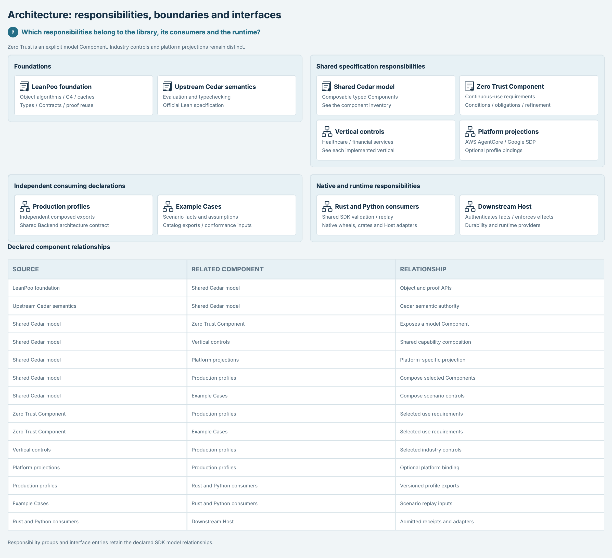
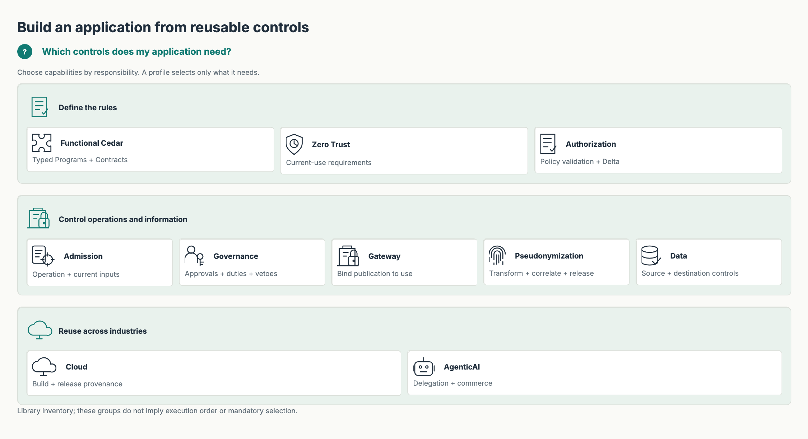
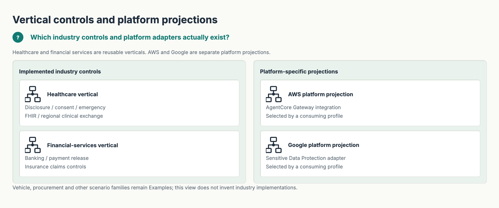
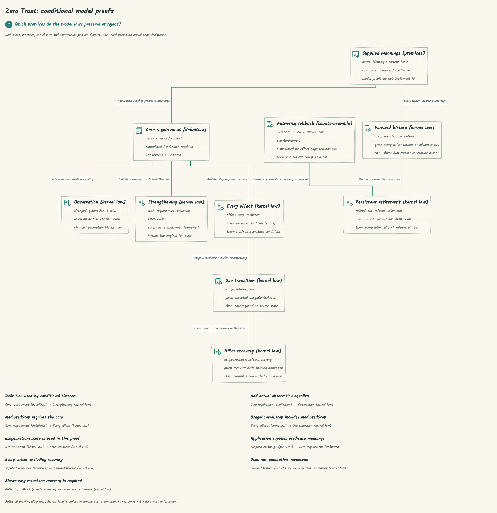
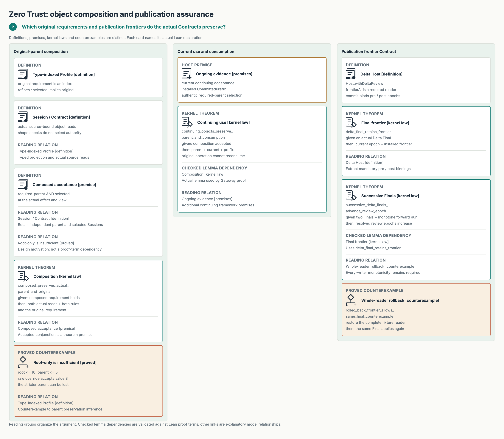
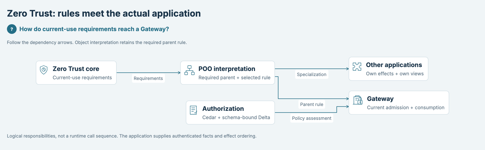

# SPDX-FileCopyrightText: 2026 hardenedlinux Linux Team and Contributors
# SPDX-License-Identifier: Apache-2.0

#+TITLE: Zero Trust Functional and POO Framework
#+LANGUAGE: en

* Component scope

Zero Trust is one important Component of the shared Cedar model, alongside
Authorization and other reusable capabilities. This detail view illustrates its
functional requirements and optional =ProfileObject= interpretation. It does
not place the LeanPoo foundation underneath Zero Trust or classify industries.
See the ,  and
 for those distinct scopes.

* Lean proof structure

The module overview below does not show a proof argument. These two source-bound
views distinguish /definitions/, /premises/, /kernel laws/ and /proved counterexamples/.
They are reading maps of selected laws, not automatically extracted proof terms.

[[file:../../dev/d2/zero-trust-model-proofs.d2][Model-proof D2]] ·  ·
[[file:../../dev/sysml/zero-trust-proofs.sysml][SysML declarations and actual Lean symbols]]

[[file:../../dev/d2/zero-trust-object-proofs.d2][Object-proof D2]] · 

| Proof layer | Actual Lean result | Premise that must remain visible |
|-------------+--------------------+----------------------------------|
| [[file:Composition.lean][Functional refinement]] | =with_requirement_preserves_framework= retains all core conjuncts. | The selected requirement is actually accepted at this effect/view. |
| [[file:Continuous.lean][Observation/currentness]] | =changed_generation_blocks= rejects an observation from another generation. | The application supplies an authoritative observation reader. |
| [[file:Continuous.lean][Mediated traces]] | =effect_step_rechecks= extracts fresh requirements for each marked effect; =run_preserves= transports an invariant. | A real transition relation and its invariant-preservation law are supplied. |
| [[file:UsageControl.lean][Usage/recovery]] | =usage_retains_core= and =usage_rechecks_after_recovery= retain the core at ongoing admission. Missing conditions/obligations block; unknown accounting blocks closure. | Recovery alone is not acceptance; obligation/mutation witnesses and actual accounting remain required. |
| [[file:ProfileObject.lean][Typed objects]] | =selected_child_preserves_original= preserves the indexed root. | A source-bound Session read and the selected requirement hold. This does not preserve every parent rule. |
| [[file:ProfileObject.lean][Retained parent composition]] | =composed_preserves_actual_parent_and_original= preserves both actual reads, both requirements and the root. | Independently required-parent and selected Sessions are retained; their conjunction is accepted. |
| [[file:../../Tests/ZeroTrust/ProfileObject.lean][Negative control]] | =raw_override_parent_weakening_counterexample= admits 8 under a root ≤10 while violating its parent ≤5; retaining the parent blocks it. | The authoritative required parent cannot be selected by the untrusted child. |
| [[file:../Gateway/ZeroTrust.lean][Gateway interpretation]] | =continuing_objects_preserve_parent_and_consumption= combines the object theorem with current use and no reconsumption. | Continuing acceptance and installed =CommittedPrefix= evidence; Host authenticity, currentness and durability remain premises. |

=FinalUse= and =zero_trust_final_use= are conditional proof interfaces, not IO
capabilities or a proof that a deployed Host authenticated facts and committed
ledgers. =final_use_preserves_authorization_delta= additionally requires the
actual admission binding, exact coverage and strongly well-formed Cedar world.
Those premises cannot be replaced by an earlier Allow or an empty solver report.

The view checks evaluate each SysML symbol through the actual SDK, then ask Lean
whether every law/counterexample is a theorem declaration and every source path
matches its actual compiled Lean module. The two arrows explicitly claiming lemma
use are additionally checked against constants in the compiled proof terms. Other
arrows describe premises or design motivation, not an extracted proof dependency.
The existing Lean
modules/tests compile their proofs independently; drawing a card issues no evidence.

* Module ownership

#+NAME: fig:zero-trust-framework
#+CAPTION: Zero Trust Component detail: functional requirements and optional POO interpretation.
#+ATTR_ORG: :width 1200
#+ATTR_HTML: :width 100% :alt Zero Trust Component detail, not a repository architecture diagram

[[file:../../dev/sysml/security-frameworks.sysml][SysML model]] · [[file:../../dev/d2/security-frameworks.d2][D2 presentation]] ·  · [[file:../../dev/README.org][Lean / SysML / renderer development path]]

Import =CedarPooSpec.ZeroTrust= as the aggregate entrypoint. Domain consumers may
import specific modules. No module in this family imports Gateway.

| Module | Responsibility |
|--------+----------------|
| Model | Typed requirement functions, Framework meanings and immutable observations |
| Composition | Higher-order adaptation, strengthening and refinement laws |
| Continuous | Actual-use checks, mutable observations/generations, revocation and trace projection |
| UsageControl | Pre/ongoing authorization, conditions, witnessed obligation actions, mutation and separate recovery/accounting closure |
| ProfileObject | Optional generic POO interpretation through actual LeanPoo Dataflow inheritance, Contract and Session |

* Composition direction

Functional requirements are reusable values. A POO profile carries its original
requirement as a type index and a proof of strengthening. Inherited extension
conjoins new requirements rather than replacing the original. Source-bound
Sessions retain the actual object's projection. No new object system is added.

Root preservation does not imply preservation of every additional parent
requirement under raw POO overrides. A root allowing values up to ten and an
approved parent limiting them to five expose this distinction: overriding the
selected field with a root-only profile still passes the root shape Contract.
=composeSessions= retains the independently required parent Session and selected
Session. =Composed.requirement= conjoins both actual projections, so invocation
cannot discard that parent requirement. No general implication decider is added.
The trusted publisher must identify the required parent from its authenticated
source/Contract commitment; a parent chosen by the child request is insufficient.

Gateway combines these functions with its own published profile and consumption
types in =CedarPooSpec.Gateway.ZeroTrust=. Other applications can supply their own
effects, views and persistence contracts without importing Gateway.
Authorization's Cedar/Delta family is an independent framework under
[[file:../Authorization/README.org][Authorization]]. Cross-framework interpretation
belongs to the application, not a reverse dependency from this core.

* Evidence boundary

Read [[file:../../docs/rfc/0010-zero-trust.org][the architecture completeness review]]
for the seven-tenet mapping, logical roles, evidence-source requirements and
application integration contract. The original predicate conjunction is a useful
effect guard, not a complete Zero Trust architecture. =UsageControl= enriches
that guard over existing transitions; it does not implement attestation, encrypted
channels, fact authorities, a Policy administrator or durable recovery.

Read [[file:../../docs/rfc/0010-zero-trust.org][RFC 0010]] for research alignment,
typed API laws and remaining Host premises. Pure proof data cannot authenticate
a state reader, persist a ledger or enforce complete mediation on a socket.
The transitive import-boundary test, generic functional/POO tests and Gateway
adapter tests are separate checks in the existing Tests aggregate.

Gateway's =currentAdmission= now supplies a typed current-Cedar assessment for
=continuing=. =current_admission_has_error_free_allow= retains its actual receipt,
original-profile refinement and canonical operation identity;
=continuing_current_admission_preserves_delta= additionally joins same-world
Delta coverage with original consumption and unknown retention. The selected
proof diagrams above are not a complete inventory of these application laws.
Current readers, original authority selection and final Host ordering remain
explicit premises. See [[file:../Gateway/README.org][Gateway's executable acceptance]].

=Observation.compareAndAdvance= models a captured-cut comparison and a checked
transition over the actual attributes. Its laws preserve the current transition,
original error and successor generation, and refuse reuse after success. All
relevant writers must advance a scoped, non-reused cut. The Host must implement
read/check/install atomically; the function is pure and grants no authorization.
The existing MediatedStep law supplies current framework requirements.

The existing =Run= relation also supports =run_generation_monotone= and
=Observation.retired_cut_refuses_after_run=. With an explicit monotonicity law
for every actual writer, including recovery, a retired cut is refused after any
finite forward run under arbitrary checked callbacks. Mediation alone does not
establish this premise; the tests retain a whole-authority rollback counterexample.
