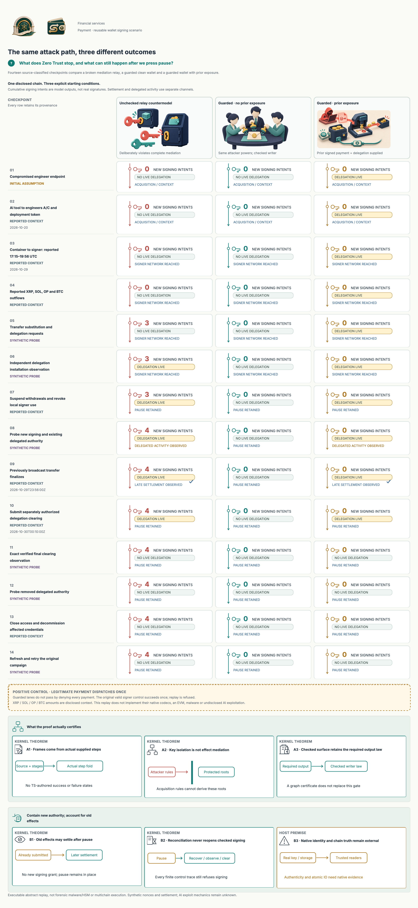

#+TITLE: Disclosed attack chain and Zero Trust differential replay
#+AUTHOR: hardenedlinux Linux Team

* What is reproduced

This is an executable /abstract/ replay of the public attack chain and its
containment boundaries, derived from the existing Binance Scenario. It preserves
the actual admitted Lean POO Attackers family and parent model. It does not
execute malware, reconstruct the undisclosed AI exploit, reproduce real wallet
signatures, run an EVM or implement the affected networks' transaction codecs.

The [[https://www.binance.com/en/square/post/384312159834579][official preliminary report]] describes recruitment-related endpoint compromise,
an internal-AI pivot on October 20, access to engineers A/C and a deployment
token, then container/signing access on October 29 during 17:15–19:56 UTC.
It reports multichain outflows, EIP-7702 delegation, a previously broadcast ETH
transfer finalizing at 23:56 UTC, and clearing authorization at 00:10 UTC on
October 30. Exact AI exploit mechanics remain undisclosed. The replay does not
attribute the last transfer to an undisclosed delegated-contract mechanism.

Those source claims are context, not authenticated observations from a live
exchange. Model steps, synthetic requests and initial exposure are classified
separately. Date-only claims remain date-only; no midnight timestamp is invented.

#+CAPTION: Fourteen checkpoints, the same attacker graph, three explicit initial/control conditions. Counters are synthetic signing intents, not real signatures or stolen balances.
#+ATTR_ORG: :width 1700

[[file:Binance2026Replay.d2][D2 source]] ·  · [[file:Binance2026Replay.lean][Lean Scenario]] · [[file:../../../../Tests/Enterprise/Payment/WalletReplay.lean][Acceptance controls]]

* One command, three executions

#+begin_src sh
just example scenarios financial-services wallet binance-replay
just example scenarios financial-services wallet binance-threat-model
#+end_src

The first command validates the source-aware replay and prints every computed
checkpoint. The second retains all existing threat gates and checks the added
interleavings. Existing 120-second producer limits, 2048-MiB heap, heartbeat
budget, version pins and mandatory negative controls are unchanged.

| Lane | Supplied condition | Computed result | What it establishes |
|------+--------------------+-----------------+---------------------|
| Unchecked relay countermodel | Same admitted acquisition graph; deliberately unchecked application writer | Four unchecked signing intents; delegated activity before clearing; existing payment eventually observed settled | A false complete-mediation premise can admit effects even while protected key capabilities remain unreachable. This is not evidence of Binance's actual relay implementation. |
| Guarded, no prior exposure | Existing PaymentHost/PaymentContainment/signing writer; clean initial wallet | No new attacker signing intent, delegation or settlement | The disclosed high-level acquisition path does not grant the modeled independent signing/business authority. |
| Guarded, prior exposure | Same guarded writer; an already handed-off payment and observed delegation are supplied initially | No new attacker signing intent; one simulated delegated use before clearing and a later settlement observation; pause/unknown remain | Containment is not retroactive cancellation. Clearing removes the modeled delegation, while reconciliation does not reopen signing. |

A separate legitimate-signer positive control dispatches once and refuses a
second call. The guarded result therefore cannot pass by denying every request.
All intent counts and checkpoint states are computed in Lean, exported through
the existing ignored build input and consumed by the TS renderer. No maintained
JSON trace, alternative package loader or TS-authored verdict table is added.

* Checkpoint coverage and provenance

[[file:../../../../CedarPooSpec/Scenarios/Replay.lean][Scenarios.Replay]] is a reusable Functional Contract around an application's
actual step function. It checks nonempty unique stage identities, source indexes,
calendar syntax and classification. Reported rows require a declared disclosure;
assumptions/probes cannot acquire historical timestamps or source attribution.
Both visual and Quint producers reject invalid replay provenance. A source
reference or valid timestamp does not prove the publisher's claim true.

| Checkpoint | Classification | Executed interpretation |
|------------+----------------+-------------------------|
| Endpoint foothold | Initial assumption | Compromised endpoint is supplied; no installer or malware runs. |
| AI to A/C and token | Reported context | The actual parent model's acquisition steps are folded; the exploit is opaque. |
| Container to signer | Reported context | Same original deployment/network capabilities; a deployment token is not reclassified as a signing credential. |
| Multichain outflows | Reported context only | No transfer is fabricated in a foreign chain codec. |
| Transfer/delegation probes | Synthetic probe | Existing guarded Host writer versus an explicit unchecked-writer countermodel. |
| Installation observation | Synthetic conditional observation | Separate from signing; code presence is supplied as a simulated chain observation, not inferred execution of signature bytes. |
| Local suspension | Reported control context | Existing pause/revocation transition, retaining already signed authority. |
| After-pause probes | Synthetic probe | New signing and existing delegated activity are separate channels; no historical new signing after suspension is alleged. |
| Late settlement | Reported time, synthetic analogue | Existing PaymentLedger.reconcile advances an already submitted sample payment, not the historical ETH transaction. |
| Clearing submission | Reported control context | Existing separately authorized clearing marker; no clearing signature or network send. |
| Clearing observation | Synthetic conditional observation | Exact wallet/network/advancing nonce and finality interpretation; no historical finality timestamp is invented. |
| After-clear probe | Synthetic probe | No new modeled delegated use after the supplied final clearing observation. |
| Closing access | Reported control context | Capabilities are removed and the writer fenced by a supplied responder transition. Real device/credential cleanup is external. |
| Refresh/retry | Synthetic probe | Existing recovery preserves pause, burns and unknown exposure; the original campaign cannot reacquire a removed root. |

The sample payment, request identifiers, nonce values and acknowledgment are
fixtures. Its reconciliation state may lag the chain; the replay does not model
Ethereum nonce execution order, consensus or per-transaction economic balances.
No proof about an abstract late settlement is presented as a native ETH trace.
The existing =ProcessorEvidence.verified= interpretation is still a Host premise:
this pure replay is not an endpoint accepting an incoming truth flag. A deployed
adapter must verify the actual exact-intent evidence independently. Reconciliation
does not clear =PaymentHost.unknown= or authorize another effect.

The late observation also explains a continuous-authorization limit: checking
every new signing call cannot establish an arbitrary invariant over unmarked
settlement/recovery updates. The existing Zero Trust =run_preserves_mediated=
law requires an actual preservation law for those updates too. “No settlement
after pause” fails that obligation here; it cannot be certified by relabelling
the observation as maintenance.

* A graph certificate is not an effect certificate

The bypass countermodel uses the /same/ certified capability rules and preserves
key isolation. It nevertheless returns unchecked signing intents because its
application writer skips the required checks. This directly refutes the
inference “the signing-key capability is unreachable, so no unsafe effect can
occur.” The generic =certified_isolation= law protects acquisition roots;
=run_preserves_outputs= additionally requires a law for the supplied writer.

The shared =Certified.checkedSurface= constructor now requires a =CheckedWriter=
for the application owner's fixed output predicate. Its =checked_outputs= law
reuses the existing trace proof and the actual selected C4 model. The guarded
replay uses that constructor; the countermodel uses the explicit lower-level
raw surface. For this fixture's retained expected transaction, a kernel proof
shows that no such checked wrapper can certify the bypass writer. Choosing a
meaningful independent predicate and realizing it physically remain owner duties;
“checked” is not itself a permission or proof of native mediation.

The earlier assurance figure's captions have been corrected from “output
isolation” to “capability isolation” and explicitly retain the writer-law
condition. Fixture-specific conclusions retain their =native_decide= dependencies;
they are not labelled as universal kernel laws. The new generic replay and
settlement-preservation laws are audited separately.

* Defense coverage without weakening the attacker

| Boundary | Reused enforcement owner | Remaining physical obligation |
|----------+--------------------------+-------------------------------|
| Endpoint / internal AI | Acquisition remains assumed; independently installed release/workload readers must not be selected by the requester | Actual software provenance, endpoint controls, process/channel authentication and the unknown AI vulnerability remediation. |
| Stolen deployment token / container | WorkloadPurpose, RegistrarAuthority and current scope/audience/command possession | Registrar roots, release identity and every deployed signer/management route. |
| Business intent and effect substitution | Existing Cedar authorization, retained ledger payment, exact transaction and current review/world binding | Real signing-byte decoder and immutable physical signing input. |
| Final use and persistence | PaymentHost exact plan/ack/cut, committed journal and consumed pending slot | Real atomic storage/handoff, antirollback fencing, key custody and full mediation. |
| Persistent delegation | Transfer-only signing profile; existing exposure quarantine and exact clearing checks | Canonical code/nonce/finality readers and separately authorized on-chain clearing. |
| Late effects / restart | Existing lifecycle reconciliation; pause and unknown remain after observation/refresh | Authentic outcome evidence, delayed inclusion/reorg handling, durable archived state and a separate authorized resumption protocol. |

The [[file:HostTrustAudit.org][eight-item Host audit]] remains authoritative for deployment evidence. Existing
=clearDelegation= signing and automatic-resumption requests remain unsupported
by this native-transfer profile; the replay does not silently add either power.

* Native multichain scope

| Disclosed network/asset | Included here | Native implementation claim |
|------------------------+---------------+-----------------------------|
| XRP | Source-context checkpoint | None: no XRP transaction codec or wallet execution. |
| Solana / SOL | Source-context checkpoint | None: no Solana instruction/signature execution. |
| Optimism / OP | Source-context checkpoint | None: no token-transfer or rollup-finality implementation. |
| Bitcoin / BTC | Source-context checkpoint | None: no UTXO/script/transaction signing implementation. |
| Ethereum / ETH and EIP-7702 | Abstract delegation/pause/clearing plus generic late-settlement analogue | No EVM, signature, nonce-history or consensus reproduction. |

* Interleavings and negative evidence

The new maintained [[file:../../../../dev/qnt/financial/WalletReplay.qnt][WalletReplay.qnt]] receives the same admitted graph through an
ignored generated instance. Ten deterministic controls include the legitimate
single dispatch, unsafe relay, late settlement, surviving delegation, clearing,
restart and isolated-root cases. The hardened model is checked through depth 12.
There is no claimed Lean/Quint refinement or exhaustive production verification.

Two mandatory depth-4 counterexamples run the /correct/ containment step and
refute deliberately overstrong claims: pause does not imply cancellation of an
old settlement, and pause does not imply removal of existing delegation. Their
ITF witnesses must retain pause and the relevant external exposure with zero
new signing intents. They are not failures of the hardened safety property.

Together with existing gates, there are 37 deterministic controls, four depth-12
checks, five deliberately broken-boundary countermodels and these two false-claim
counterexamples. None replace the old controls. Actual cryptography, malware,
HSM/MPC enforcement, chain execution and production crash testing remain absent.

* Primary references

- [[https://www.binance.com/en/square/post/384312159834579][Binance official preliminary report mirror]]; original disclosure and access dates remain in the actual Scenario metadata.
- [[https://eips.ethereum.org/EIPS/eip-7702][EIP-7702]] for retained delegation and explicit clearing semantics.
- [[https://csrc.nist.gov/pubs/sp/800/207/final][NIST SP 800-207]] for authentication/authorization at an enforced resource boundary, rather than trust from network location. This Scenario is not deployment certification.
