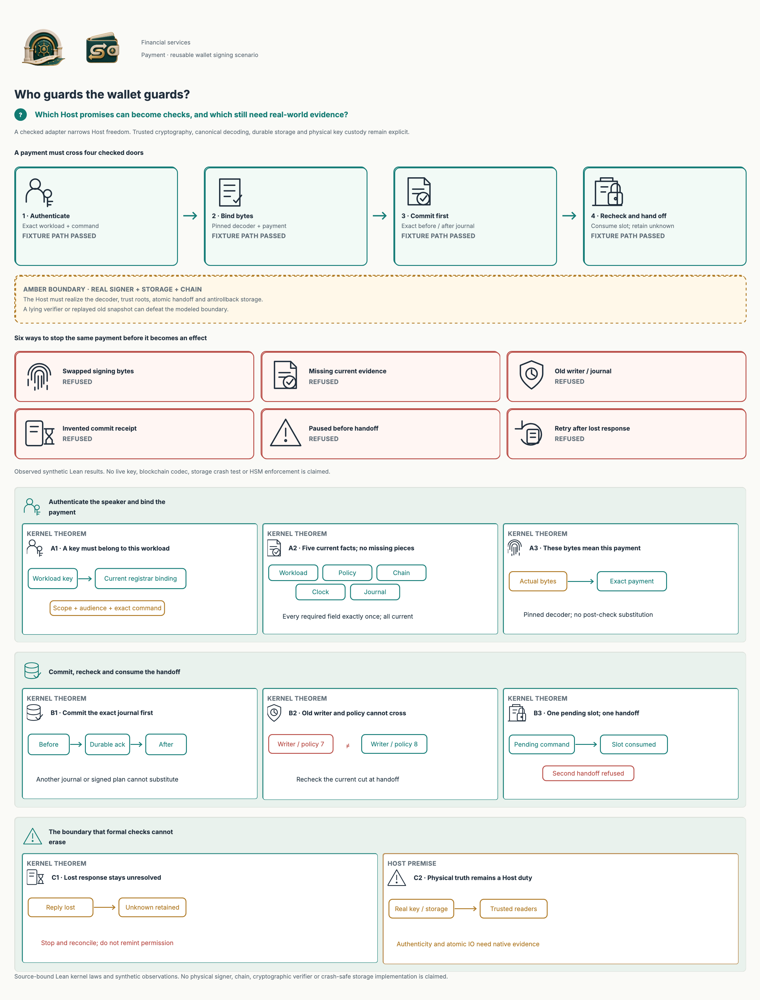

#+TITLE: Binance wallet Scenario: Host trust audit
#+AUTHOR: hardenedlinux Linux Team

* Scope and verdict

This is an audit of the existing =binance-2026-10-29= Scenario, not another
reported incident. [[file:Binance2026Host.lean][Its synthetic Host interpretation]] derives inputs from the same
wallet Scenario. No live signer, incident infrastructure or recovery service is
implemented. The report does not authenticate Binance's disclosure.

The former =PaymentSigning.Current= record leaves interpretation functions to
the Host. [[file:../../../../CedarPooSpec/Vertical/FinancialServices/PaymentHost.lean][PaymentHost]] narrows how independently installed interpretations can be
used: it composes the existing RegistrarAuthority, FactAuthority, signing,
containment, Zero Trust refinement and Lean POO declarative Contract. A request
cannot supply a decoder, source reader, registrar or acknowledgment verifier.
The same admitted Attackers family reuses the original campaign through the
composed writer; its acquisition graph is not copied. A clean signer positive
control permits one handoff and refuses a repeated call.

Their correctness remains an external premise; moving a predicate behind a
record field does not prove its interpretation.

#+CAPTION: Four checked doors, six observed refusals, and the physical trust boundary. Teal kernel laws are conditional; amber obligations still require native evidence.
#+ATTR_ORG: :width 1500

[[file:Binance2026Host.d2][D2 source]] ·  · [[file:../../../../Tests/Enterprise/Payment/WalletHost.lean][Lean controls]] · [[file:../../../../dev/qnt/financial/WalletHost.qnt][Finite threat model]]

* Audit of every original Host premise

All deployment evidence below is /required but not collected by this Scenario/.
The adapter is a pure specification. Passing its tests does not qualify a
physical deployment or establish independent control domains.

| Original Host premise | Model constraint and existing owner | New refusal / retained negative evidence | Runtime defense and required evidence |
|-----------------------+-------------------------------------+-----------------------------------------+---------------------------------------|
| Actual active policy and authoritative facts | =FactAuthority.acceptsAll= requires exactly workload, policy, chain, clock and journal facts; every fact names the actual Gateway world. Existing PaymentSigning checks active authorization and policy epoch; the command cut binds world, effect and full review identity. | Missing, duplicate, claimed, foreign, stale-generation, wrong-value and expired facts; frozen authorization; changed chain nonce. | Pin reader/verifier identities outside requester control; bind deployed policy/schema/source generation to independently authenticated observations. Demonstrate policy replacement and clock rollback fault tests against the actual adapter. An exact signed lie is still a lie. |
| Genuine business intent and independent control domains | Keep the existing approved payment, exact transaction, audit verifier and current-use authorization. Additional evidence and registrar checks strengthen the original requirement through =requirement_preserves_original=. | Existing lying-audit-verifier control is retained; current frozen policy still refuses a previously prepared command. | Separate deployment, review, release and signing authority; enforce independently held approval roots and narrowly scoped recovery authorization. Demonstrate that one compromised administrative domain cannot approve itself. Multiple labels or keys do not prove independence. |
| Authenticated workload and release identity | Reuse =PublicationReview.RegistrarAuthority=: exact current subject, incarnation, key, scope, audience, epoch, serial, nonrevocation and command-specific possession. Bind its subject/release to the payment caller and epoch to the current writer. | Changed subject, release, public key, scope, audience, epoch or serial is refused. | Authenticate the actual process/channel and proof of possession over the exact command; pin registrar roots, protect keys and measure/verify the actual release. Test compromised deployment credentials against every signer and management entrypoint. Synthetic issued/possession predicates do not implement signatures or attestation. |
| Exact physical signing input | The independently installed decoder must return the exact approved Transaction for the actual nonempty byte list; reject values outside the byte range. Recheck the same bytes, command and current cut immediately before logical handoff. | Swapped/empty/invalid bytes and post-plan substitution are refused. A second, disagreeing chain interpretation is retained to show decoder truth is not proved. | Use the actual chain/network transaction codec, domain separation and canonicality rules; bind the checked immutable buffer to the HSM/MPC signing input. Run independent codec differential/fuzz vectors and post-check mutation tests. The fixture byte sequence is deliberately not an Ethereum encoder. |
| Complete mediation and key custody | =emit= is the sole modeled handoff and retains payment, containment, registrar and fact checks. It consumes the pending slot before returning bytes; =no_second_emission= refuses another handoff from its successor. | No pending slot, pause before handoff, credential revocation and reuse of the successor are refused. Reusing the old immutable committed state still succeeds in the retained counterexample. | Remove raw-hash/debug/management bypass routes; keep physical keys inaccessible except through the enforced adapter. Test route inventory and direct calls, key export policies and malicious binary replacement. Pure API values are neither affine capabilities nor proof of complete physical mediation. |
| Linearization and persistence | Prepare the exact before/after journal, including ledger, exposure, revocation, writer epoch, pending command and unknown bit. Commit recomputes against the actual pre-state and requires a trusted acknowledgment of that same plan. Handoff rechecks the exact committed journal/current cut. | Forged/foreign acknowledgment, changed before/after state, old writer, old ledger and unverified receipt are refused. A lying acknowledgment verifier can admit a forged receipt. Quint retains no-durability and old-state-replay countermodels. | Realize compare-and-swap, authenticated durable acknowledgments and the handoff transition with atomic storage ordering. Fence old writers and rollback copies; persist nonce burns, pending/unknown state and containment together. Demonstrate concurrent-writer, crash/power-loss, failover and backup-restore tests against the actual database/signer. The pure transition does not prove fsync, quorum or hardware monotonicity. |
| Chain truth and existing delegated authority | Retain PaymentContainment quarantine and exact wallet/network/advancing-nonce clearing; verified final observation removes only delegation, never pause. Host facts are additionally inventory/world/current-cut bound. | Existing unverified, unfinalized, foreign-wallet/network, wrong-nonce and replacement-code controls remain. A different current chain nonce blocks handoff. | Obtain authenticated canonical state and finality through independent chain readers; handle reorgs and outstanding authorizations. Separately authorize, submit and observe emergency clearing. No local pause can revoke code already executing independently on-chain; no EVM or finality implementation is present. |
| Outcome completeness and recovery | Commit retains unknown before handoff; emit consumes the pending slot and retains unknown afterward. Refresh preserves both fields and the existing containment journal. =unknown_cannot_prepare= blocks a fresh plan; recovery cannot manufacture a resend. | Lost-response retry and refresh/retry are refused; old-state replay remains a Host counterexample. | Reconcile the exact outstanding signed intent with authenticated signer/provider/chain evidence; keep unresolved outcomes and delegated authority durably fenced. Test lost responses, delayed inclusion, restart, failover and retry races. There is deliberately no auto-resume or resolution API; availability and eventual settlement are not proved. |

* The checked protocol and its limits

1. =prepare= retains every existing payment/containment check, independently
   admitted registrar binding and current fact inventory. It returns a pure
   plan: exact input bytes, source cut and complete journal transition.
2. =commit= recomputes that plan against the current pre-state and checks the
   independently verified acknowledgment names the exact same plan. Its return
   describes committed pending/unknown state; it performs no storage IO.
3. =emit= rechecks authentic current facts, decoder, credential, active payment,
   containment, exact source cut, acknowledgment and dispatched journal. It
   returns an immutable successor with the pending slot consumed and unknown
   exposure retained. It does not invoke a physical signing device.
4. =State.refresh= preserves pending/unknown exposure and delegates ledger and
   containment retention to the existing recovery function. A changed source
   cut may leave a safe, blocked unresolved intent. Reconciliation/resumption
   requires a separate authorized protocol; this model promises no liveness.

The durable journal contains concrete typed values. It introduces no new digest,
JSON receipt archive or assumption that a hash is collision-free. Existing
ignored build receipts retain verification evidence; Git continues to own
maintained sources. The original payment signer and containment APIs remain
lower-level specifications. A deployment must enforce the composed adapter on
all actual routes to claim its conditional guarantee.

* Validation interpretation

The Lean suite checks positive handoff, refusal controls and all three retained
runtime counterexamples. Kernel laws retain exact decoder meaning, registrar
admission, fact inventory, durable plan, current cut and consumed pending state;
axiom audits do not promote fixture =native_decide= results to universal laws.

The independent finite Host model adds nine deterministic traces, depth-12
safety and mandatory depth-4 no-durability / old-state-replay counterexamples.
The original signing and containment gates remain unchanged: 27 deterministic
traces in total, three depth-12 checks and five required counterexamples. These
are bounded checks of abstract trusted bits, with no claimed Lean/Quint
refinement, crypto verification, production crash test or complete attack replay.

* Design references

- [[https://csrc.nist.gov/pubs/sp/800/207/final][NIST SP 800-207: Zero Trust Architecture]]: authenticate/authorize use through an enforced policy boundary; network location alone does not establish trust. Our model covers an application contract, not conformance certification.
- [[https://eips.ethereum.org/EIPS/eip-7702][EIP-7702]]: retained code delegation and its explicit clearing motivate the distinction between local suspension and actual on-chain removal. Clearing execution, observation authenticity and finality remain external.
