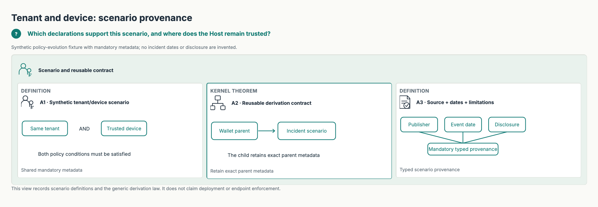

#+TITLE: Cedar Authorization Scenarios
#+OPTIONS: toc:nil

* Source-bound scenario family

[[file:../../CedarPooSpec/Scenarios/README.org][The shared functional Scenarios layer]] requires typed metadata and retains
actual parent provenance when binding a derived model. The
[[file:FinancialServices/Wallet/Base.lean][synthetic wallet signing scenario]] is reused by the
[[file:FinancialServices/Wallet/Binance2026.lean][Binance 2026 incident scenario]]. Its
[[file:FinancialServices/Wallet/README.org][audit]] separates reported dates and preliminary source claims from modeled
security properties and Host assumptions. More incidents can specialize these
existing owners without copying the wallet or Attackers implementation.

#+begin_src sh
just example scenarios financial-services wallet binance
just example scenarios financial-services wallet binance-threat-model
#+end_src

* Tenant document access during policy migration

[[file:TenantDevicePolicyEvolution.lean][TenantDevicePolicyEvolution.lean]] is an executable Cedar scenario, not a
replacement evaluator. Alice belongs to tenant A. Documents A and B belong
to tenants A and B. The request context contains a typed =deviceTrusted=
fact. The desired rule is: permit reading only a document in the same tenant
from a trusted device.

The starting policy set is realistic during migration: a tenant-scoped
permit and a baseline broad read permit coexist. This matters because Cedar
combines all applicable policies. Tightening one permit cannot revoke a
different permit. A forbid has precedence over permits, while a policy that
errors is excluded from the decision. Cedar documents both behaviors in its
[[https://github.com/cedar-policy/cedar-docs/blob/main/docs/collections/_other/security.md][security guidance]]. The skip-on-error consequence was illustrated by
[[https://github.com/cedar-policy/cedar/issues/2428][Cedar issue #2428]]. This example uses typed attributes and validates the
policy sets; it does not reproduce that issue's malformed =in= expression.

| Composed root | Change from parent | Tenant A, trusted | Tenant B, trusted | Tenant A, untrusted |
|---------------+--------------------+-------------------+-------------------+---------------------|
| Base | Tenant permit and baseline permit | Allow | Allow | Allow |
| TenantStrict | Overlay device trust on the tenant permit | Allow | Allow | Allow |
| DeviceVeto | Independently forbid an untrusted device | Allow | Allow | Deny |
| Composed | C4 joins both sibling controls | Allow | Allow | Deny |
| Remove | Retire the inherited baseline permit | Allow | Deny | Deny |

Policy IDs name authorization behavior. =unrestricted-read= is the
deliberately broad baseline; =Remove= withdraws it through the current C4
module API. These baseline policies are executable negative controls for
composition and revision proofs. They do not denote deprecated APIs.
All affected cases use the shared Functional and current Lean-POO contracts.

The surprising =TenantStrict= row is the reason for the composition example.
Its overlay changes one policy ID, but the old independent permit still
authorizes the request. =DeviceVeto= closes the untrusted-device path but
cannot close cross-tenant access. =Composed= inherits both controls, and
=Remove= retires the remaining broad grant. Cedar evaluates every resulting
policy set.

* Why POO appears here

The modules declare five edits over five roots: two initial extends, an
independent tenant overlay, an independent device veto, and one final remove.
C4 composes the sibling branches without copying their full policy sets.
The model stages each branch with =Model.extend= and joins them with
=Model.mix=, preserving the same graph that the named modules describe.
Materializing all five roots independently would store twelve policy records
(2 + 2 + 3 + 3 + 2). The source names five edits and lets the compiler produce
each Cedar policy set. This is a count of authored records in this scenario,
not a general LOC or maintenance-cost benchmark.

The compiler rejects duplicate IDs, overlays of absent IDs, and ambiguous
sibling edits. Those failures happen before Cedar evaluation. The example
checks the C4 order, each branch's single-policy delta, policy IDs, validator
results, authorization decisions,
empty runtime-error lists for the final requests, and a Cedar soundness
theorem carried by a Lean-POO certificate. A policy revision selects the
policy-validation obligation and leaves the schema, request, and entity
obligations untouched. Cedar remains authoritative for
validation, permit/forbid aggregation, and soundness; POO owns inheritance,
edit intent, conflict detection, and proof-object dependency management.

[[file:TenantDevicePolicyEvolutionExport.lean][The manifest exporter]] sends all
fifteen root/request decisions to the official Cedar Rust authorizer. It
also checks the five generated [[file:TenantDevicePolicies/remove.cedar][policy
revisions]] after Cedar reparses them. This closes the concrete-language
boundary for the existing POO edit sequence; the malformed-policy diagnostic
remains a Lean-only negative case because its policy set fails validation.

#+begin_src sh
lake env lean Examples/Scenarios/TenantDevicePolicyEvolution.lean
just prepare-tenant-device-manifest
just check
#+end_src

* POO composition scenarios

The tenant-device example now composes two independent controls before
retiring a shared baseline grant. The examples below scale that pattern to
multiple owners, proof reuse, and localized emergency changes.

| Scenario | POO leverage | Evidence |
|----------+--------------+----------|
| [[file:../Health/ClinicalBreakGlass.lean][Clinical break-glass]] | Privacy, security, and emergency owners form a diamond; a changed policy reuses unchanged policy certificates. | [[file:../Health/README.org][Health case and sources]] |
| [[file:../Governance/AttestedDataAccess.lean][Attested data governance]] | Owner, platform, and compliance branches compose; one platform edit identifies affected descendants and reusable proof obligations. | [[file:../Governance/README.org][Governance case and sources]] |
| [[file:../Governance/TicketSharing.lean][Ticket sharing]] | Template edits become exact POO overlay, remove, and extend revisions with incremental certificates. | [[file:../Governance/README.org][Governance case and sources]] |
| [[file:../Enterprise/Payment/PaymentRelease.lean][Payment release]] | Budget, duties, risk, and baseline retirement branches close holes left by any branch alone. | [[file:../Enterprise/Payment/README.org][Payment case and sources]] |
| [[file:../Enterprise/Agent/Chain/AgentChain.lean][Agent chain]] | One delegation root serves variable hop counts; a one-edge freeze and restoration stay local, and conflicting sibling edits fail. | [[file:../Enterprise/Agent/Chain/README.org][Agent chain case and sources]] |
| [[file:../Enterprise/Agent/Payment/AgentPayment.lean][Agent payment]] | Account, amount, and origin owners compose independent vetoes; an account freeze and restoration affect one policy ID. | [[file:../Enterprise/Agent/Payment/README.org][Agent payment case and sources]] |
| [[file:../Enterprise/Agent/DataFlow/AgentDataFlow.lean][Agent data flow]] | Data classification and security review branches each leave a distinct leak; C4 closes both without changing the read root. | [[file:../Enterprise/Agent/DataFlow/README.org][Agent data flow case and sources]] |
| [[file:../Enterprise/Agent/Session/BoundedSession.lean][Bounded agent session]] | Delegated intent, action history, and session budget each leave a distinct hole; C4 composes them, then an incident freeze and recovery remain local. | [[file:../Enterprise/Agent/Session/README.org][Session case and 2026 research sources]] |
| [[file:../Enterprise/Agent/Fanout/SharedBudget.lean][Shared agent budget]] | Per-worker controls allow fanout past a parent cap; C4 adds a shared budget, and a stale-read trace shows why host admission must be atomic. | [[file:../Enterprise/Agent/Fanout/README.org][Fanout case and 2026 research sources]] |
| [[file:../Enterprise/Vehicle/Uptane/SupplierTransition.lean][Uptane supplier transition]] | Image and Director authority are retired independently, then a new supplier is added; the unchanged manifest certificate is reused. | [[file:../Enterprise/Vehicle/Uptane/README.org][Uptane case and sources]] |
| [[file:../Enterprise/Vehicle/VLA/CommandBoundary.lean][AI driving command boundary]] | A visual-text command hijack motivates independent pedestrian and provenance owners; cohort quarantine stays local. | [[file:../Enterprise/Vehicle/VLA/README.org][VLA case and sources]] |
| [[file:../Enterprise/Vehicle/Mission/SuccessorBoundary.lean][Successor-safe mission command]] | Platform-safe successors can still skip checkpoints or exhaust mission budget; three POO owners compose and one evidence overlay closes a stale-horizon gap. | [[file:../Enterprise/Vehicle/Mission/README.org][Mission case and sources]] |

[[file:../Language/README.org][Language examples]] check Cedar syntax and export
coverage. They are adapter conformance cases, not industry composition
scenarios.

* Scenario-local figures

Every maintained scenario has an adjacent D2 declaration and generated SVG:
=FinancialServices/Wallet/Base.d2= and =Base.svg= describe the reusable parent;
=FinancialServices/Wallet/Binance2026.d2= and =Binance2026.svg= describe the
reported incident; =TenantDevicePolicyEvolution.d2= and its SVG describe the
synthetic tenant/device example. This family classification keeps each reported
incident beside its reusable domain parent rather than in a parallel attack tree.

The top-level =Project.sysml= declares the scenario figure inventory. Typed view
models remain under =dev/sysml= and the existing =dev/ts= renderer produces
adjacent SVG and PNG, with ignored build receipts. Run =just -f dev/Justfile render= from the
repository root, then =just -f dev/Justfile test=. Receipts bind exact D2, SysML,
Lean and renderer inputs; the existing 12px readability gate also applies here.
These are source-bound assurance maps, not evidence of a live incident replay.

The Binance incident also provides a separate =Binance2026Assurance.d2/svg=
appendix. The primary incident picture favors the reported story and a refusal
flow; detailed declaration cards remain available in that optional figure.

* Tenant and device example

#+CAPTION: The existing synthetic tenant/device scenario uses the shared metadata and derivation contract.
#+ATTR_ORG: :width 1000

