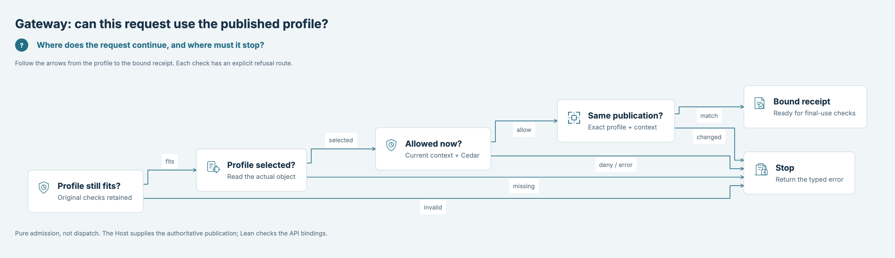
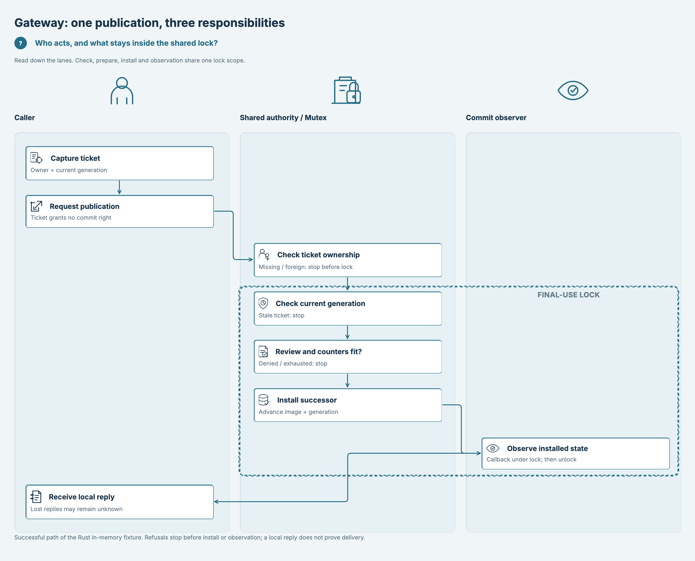
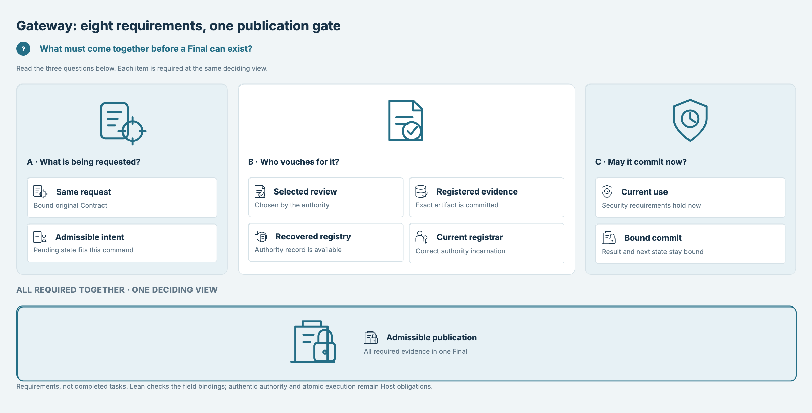

# SPDX-FileCopyrightText: 2026 hardenedlinux Linux Team and Contributors
# SPDX-License-Identifier: Apache-2.0

#+TITLE: Cedar POO Spec
#+OPTIONS: toc:2

Cedar POO Spec composes typed authorization capabilities using
[[https://github.com/tao3k/lean-poo][LeanPoo]] and the upstream
[[https://github.com/cedar-policy/cedar-spec][Cedar Lean specification]].
It binds policy construction, validation, Contracts and proofs to concrete
requests, then checks exported cases with the official Rust Cedar authorizer.

The canonical repository is [[https://github.com/hardenedlinux/cedar-poo-spec][hardenedlinux/cedar-poo-spec]].
=tao3k/cedar-poo-spec= is a mirror.

* Architecture views

Start with the system overview, then choose a question from the picture index.
Zero Trust is a Component of the shared Cedar model. Applications compose it
with Authorization and other capabilities on the LeanPoo/Cedar foundations.

** System overview

Where do checked rules become application responsibilities?

[[file:dev/d2/architecture-overview.png]]

Read next: [[file:Productions/README.org][Production profiles]], [[file:Examples/README.org][Example scenarios]] and
[[file:Productions/Backend.org][shared backend responsibilities]]. These consumers remain independent.

** Picture index

Each view has a different purpose. Open its full image, then follow the adjacent
guide for the definitions, assumptions and implementation scope.

| View and full image | Question it answers | Read next |
|---------------------+---------------------+-----------|
| [[file:dev/d2/architecture-overview.png][System overview]] | What belongs to the library, consumers and Host? | [[file:Productions/README.org][Production profiles]] · [[file:Productions/Backend.org][Backend design]] |
| [[file:dev/d2/model-components.png][Reusable capabilities]] | Which controls can an application compose? | [[file:CedarPooSpec/Functional/README.org][Functional Cedar]] · [[file:docs/functional-coverage.org][Case coverage]] |
| [[file:dev/d2/verticals-platforms.png][Industries and platforms]] | Am I choosing an industry rule or a platform adapter? | [[file:CedarPooSpec/Vertical/Health/README.org][Healthcare]] · [[file:CedarPooSpec/Vertical/FinancialServices/README.org][Financial services]] · [[file:CedarPooSpec/Platform/Google/README.org][Platform example]] |
| [[file:dev/d2/security-frameworks.png][Zero Trust responsibilities]] | How do current-use requirements reach Gateway? | [[file:docs/zero-trust-contract.org][Framework contract]] · [[file:CedarPooSpec/Authorization/README.org][Authorization and Delta]] |
| [[file:dev/d2/zero-trust-model-proofs.png][Zero Trust model proofs]] | What follows from the premises, and what breaks under rollback? | [[file:docs/rfc/0010-zero-trust.org][Model, papers and proof boundaries]] |
| [[file:dev/d2/zero-trust-object-proofs.png][Object and publication proofs]] | How are parent rules, consumption and review epochs preserved? | [[file:CedarPooSpec/ZeroTrust/README.org][Object composition and theorem guide]] |
| [[file:dev/d2/lean-catalog.png][Native catalog counts]] | Which transport forms occur in the 51-entry catalog? | [[file:Examples/README.org][Scenario catalog]] · [[file:docs/rfc/0006-schema-bound-cedar-replay.org][Schema-bound replay]] |
|  | Which checks continue a request, and which stop it? | [[file:CedarPooSpec/Gateway/README.org][Gateway admission API]] |
|  | Who checks, installs and observes under the shared boundary? | [[file:dev/README.org][Workflow and swimlane reading guide]] · [[file:docs/zero-trust-contract.org][Host obligations]] |
|  | Which eight conditions must hold together? | [[file:CedarPooSpec/Gateway/PublicationReview.lean][Final record and laws]] · [[file:docs/diagram-review.org][Comprehension tasks and glossary]] |

** Choose reusable capabilities

Which responsibilities does this application need? Select capabilities rather
than treating the catalogue as a mandatory execution sequence.

[[file:dev/d2/model-components.png]]

Read next: [[file:CedarPooSpec/Functional/README.org][typed Programs and Contracts]],
[[file:CedarPooSpec/Authorization/README.org][policy validation and Delta]], or
[[file:CedarPooSpec/AgenticAI/README.org][agent capabilities]].

** Separate industry rules from platform integrations

Industry controls describe what must be protected; a platform projection binds
selected controls to a particular integration.

[[file:dev/d2/verticals-platforms.png]]

Read next: [[file:CedarPooSpec/Vertical/Health/README.org][Healthcare]],
[[file:CedarPooSpec/Vertical/FinancialServices/README.org][Financial services]],
[[file:CedarPooSpec/Platform/AWS/AgentCore/README.org][AWS AgentCore]], or
[[file:CedarPooSpec/Platform/Google/README.org][Google Sensitive Data Protection]].

** Locate Zero Trust inside the shared model

Current-use requirements and authorization assessment meet at an application's
actual effect boundary. Proofs and authenticated Host inputs have distinct roles.

[[file:dev/d2/security-frameworks.png]]

Read next: [[file:docs/zero-trust-contract.org][framework contract]],
[[file:CedarPooSpec/ZeroTrust/README.org][proof maps and required premises]], or
[[file:docs/rfc/0010-zero-trust.org][research sources and security-model limits]].

The [[file:docs/diagram-review.org][student-perspective review]] covers all ten pictures, comprehension tasks,
remaining reading difficulties and the full Lean symbol lookup. The
[[file:dev/README.org][rendering guide]] explains how D2/SysML sources, native Lean checks and
source-bound image receipts stay aligned. Open a full image for fine detail;
a thumbnail is not a substitute for the linked definitions or proofs.

* Architecture and ownership

| Layer | Owner | Responsibility |
|-------+-------+----------------|
| Object algorithms | LeanPoo | C4 resolution, typed object composition, dependency tracking, certified preparation and reuse. |
| Cedar semantics | Upstream cedar-spec | Expressions, evaluation, typechecking, extensions and soundness. |
| Reusable integration | =CedarPooSpec/= | Cedar-specific typed capabilities, Contracts, policy revisions, proofs and transport. |
| Production profiles | =Productions/= | Composed profiles and versioned exports, independent of Examples and Tests. |
| Scenario validation | =Examples/= and =Tests/= | Concrete cases, independent oracles, negative controls and cross-language conformance. |
| Native replay | =rust/= | SDK admission, replay receipts and domain/Host adapters. |
| Deployed effects | Downstream Host | Authenticate current facts, enforce decisions, persist effects and manage runtime authority. |

The dependency direction is from scenarios and production profiles toward the
shared library. The library and Production import closures exclude Examples
and Tests. A checked model or a successful replay does not establish deployed
Host behavior; simulation is sufficient for this repository's conformance cases.

** Shared capabilities and domain composition

[[file:CedarPooSpec/Functional/README.org][Functional Cedar]] selects typed compile,
validate, publish and authorize operations. Its prepared Programs retain checked
policy data for an immutable model/schema; each request still receives its own
authorization. [[file:docs/functional-coverage.org][Coverage]] maps all applicable
families to their types, Contracts, proofs and Rust replay.

| Library area | Scope |
|--------------+-------|
| [[file:CedarPooSpec/Authorization/README.org][Authorization]] and [[file:CedarPooSpec/ZeroTrust/README.org][ZeroTrust]] | Reusable decision and effect-boundary frameworks. |
| [[file:CedarPooSpec/Pseudonymization/README.org][Pseudonymization]], [[file:CedarPooSpec/Gateway/README.org][Gateway]], =Admission/=, =Governance/= | Cross-industry lifecycle, admission and control composition. |
| [[file:CedarPooSpec/Data/Lakehouse/README.org][Data]], [[file:CedarPooSpec/AgenticAI/README.org][AgenticAI]], [[file:CedarPooSpec/Cloud/README.org][Cloud]] | Cross-industry data, agent and build/release capabilities. |
| =CedarPooSpec/Vertical/= | Reusable healthcare and financial-services controls. |
| =CedarPooSpec/Platform/= | Platform-specific projections, including AWS. |

Industry scenarios and deployment-specific facts are composed in Examples or
downstream applications. [[file:Productions/Backend.org][Shared backend architecture]]
belongs to Production and serves multiple profiles/providers; it is independent
of any one AgenticAI example.

* Repository organization

| Path | Contents and entrypoint |
|------+-------------------------|
| =CedarPooSpec/= | Shared Lean library; [[file:docs/rfc/0008-functional-cedar-capabilities.org][Functional capability design]]. |
| [[file:Productions/README.org][Productions/]] | Production profile/export contracts and the shared backend design. |
| [[file:Examples/README.org][Examples/]] | Scenario index and adjacent modeling notes. |
| [[file:Tests/README.org][Tests/]] | Proof regressions, rejection controls and conformance fixtures. |
| [[file:rust/README.org][rust/]] | Cargo workspace, crate ownership and feature/profile selection; packages live directly under =rust/*=. |
| [[file:Benchmarks/README.org][Benchmarks/]] | Lean/Rust native workloads and separate process/resource observation. |
| =python/packages/= | Rust-built Python API plus separate external testing/process tools. |
| =docs/= | RFCs, integration contracts, coverage and performance audits. |

* Build and verify

Use the pinned [[file:lean-toolchain][Lean toolchain]], Rust/Cargo, Just and uv.
Additional full-gate prerequisites are documented by the corresponding recipes.

#+begin_src sh
lake build
just check-quick
just check
#+end_src

=check-quick= builds the library and Lean tests. =check= runs the complete Lean,
Rust and scenario qualification. =just --list= lists focused checks;
=just lean-poo-api= inspects the locked dependency's public modules.
The [[file:lakefile.toml][Lake dependencies]] and lockfile pin exact revisions;
a deliberate dependency update is followed by =just sync= and complete checks.

The acceptance unit includes the complete 51-entry example catalog and all nine
materialized object families. Types, projection Contracts, semantic proofs and
independent Rust authorization must agree. [[file:docs/functional-coverage.org][The coverage audit]]
records the inventory and retained controls. [[file:docs/ci-modules.org][CI module ownership]]
separates core, Zero Trust/authorization, healthcare, financial services,
platforms, governance, cross-module conformance, native Python wheels, resources and views.

* Native performance

#+begin_src sh
just bench-catalog-preparation
just bench-functional-catalog
#+end_src

Lean owns source construction, Program preparation, serialization workloads,
correctness checks and native timers. Rust owns SDK replay and allocation
counters. [[file:docs/python-native.org][Native Python APIs]] are built from Rust with maturin/PyO3;
the separate testing package retains necessary external process/resource observation.
The [[file:Benchmarks/README.org][benchmark guide]] documents fixed workloads,
entrypoints and evidence handling. Keep all samples, including regressions;
algorithm timings, full-process wall time, CPU, allocations and RSS are separate
observations. Generated tables/logs belong in ignored build directories or CI
artifacts, not the source history.

** Evidence-bound effects and independent audit

[[file:docs/protocol/gateway-effect.org][The versioned Gateway protocol]] connects independently trusted field sources,
review/publication identities and exact effect generations to the shared
Zero Trust Contract. Its Lean model and optional Rust simulator cover the
applicable catalogue with signed precommits, outcome receipts and independent
provider reconciliation. [[file:docs/protocol/gateway-effect-v1.schema.json][Wire schema]] and
[[file:docs/external-security-audit.org][external research audit]] distinguish simulated guarantees from deployment
obligations. Validate with =just check-effect-protocol=.

* Design and evidence

- [[file:docs/rfc/0001-certified-authorization.org][Certified authorization]] and [[file:docs/rfc/0002-policy-module-composition.org][policy composition]] define the core integration.
- [[file:docs/rfc/0003-cedar-language-export.org][Language export]], [[file:docs/rfc/0005-cedar-replay-receipts.org][replay receipts]] and [[file:docs/rfc/0006-schema-bound-cedar-replay.org][schema-bound replay]] define cross-language boundaries.
- [[file:docs/lean-poo-alignment.org][LeanPoo alignment]] and [[file:docs/functional-coverage.org][whole-repository coverage]] connect APIs to cases and proofs.
- [[file:docs/native-performance-plan.org][Native lifecycle plan]] and [[file:docs/native-dataflow-acceptance.org][all-domain algorithm acceptance]] separate measured results, non-wins and remaining work.

* Credits and license

Cedar and =cedar-spec= are developed by the
[[https://github.com/cedar-policy][Cedar project]]. Lean-POO draws on the POOF work of
François-René Rideau, Alex Knauth, and Nada Amin. Their projects retain
their own copyright and licenses. This repository is licensed under the
Apache License 2.0; see [[file:LICENSE][LICENSE]].
