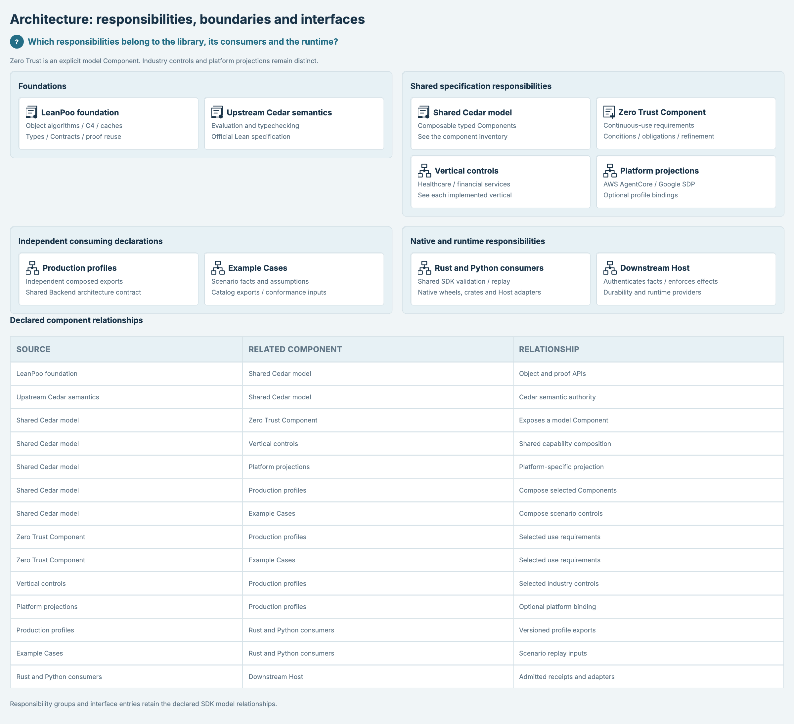
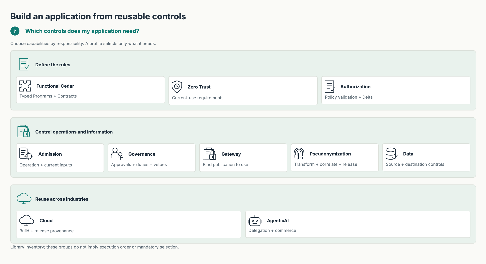
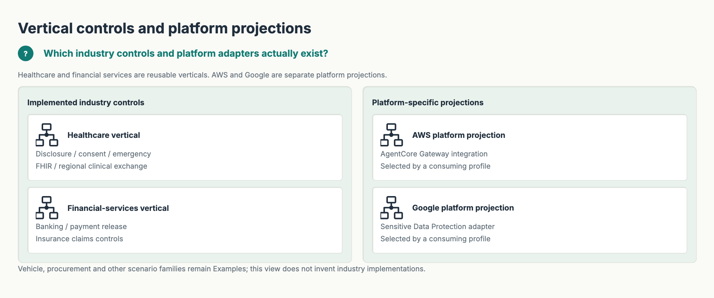
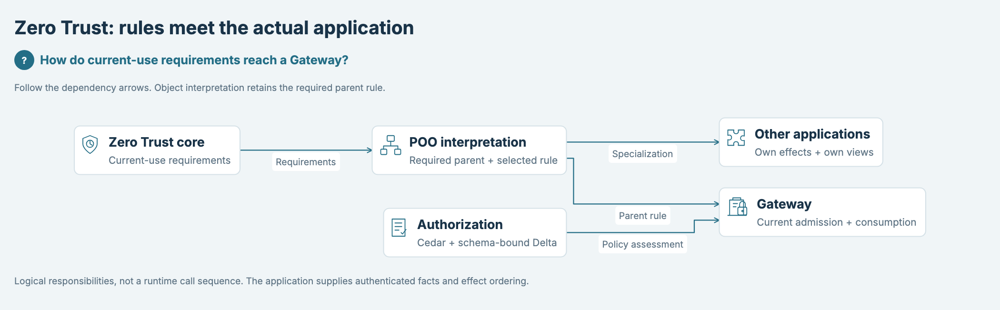
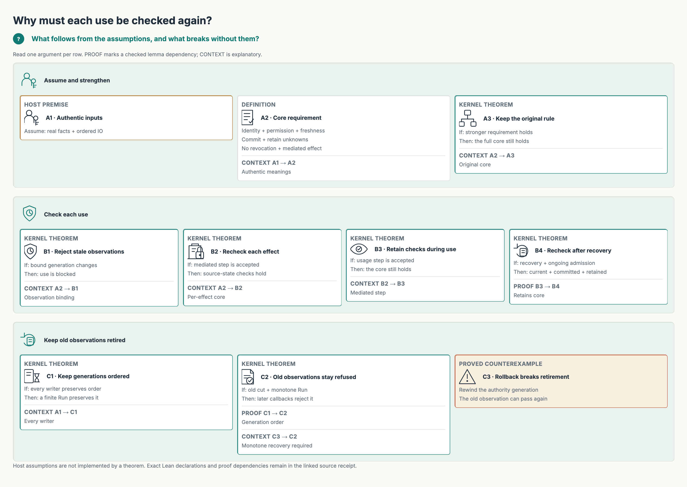
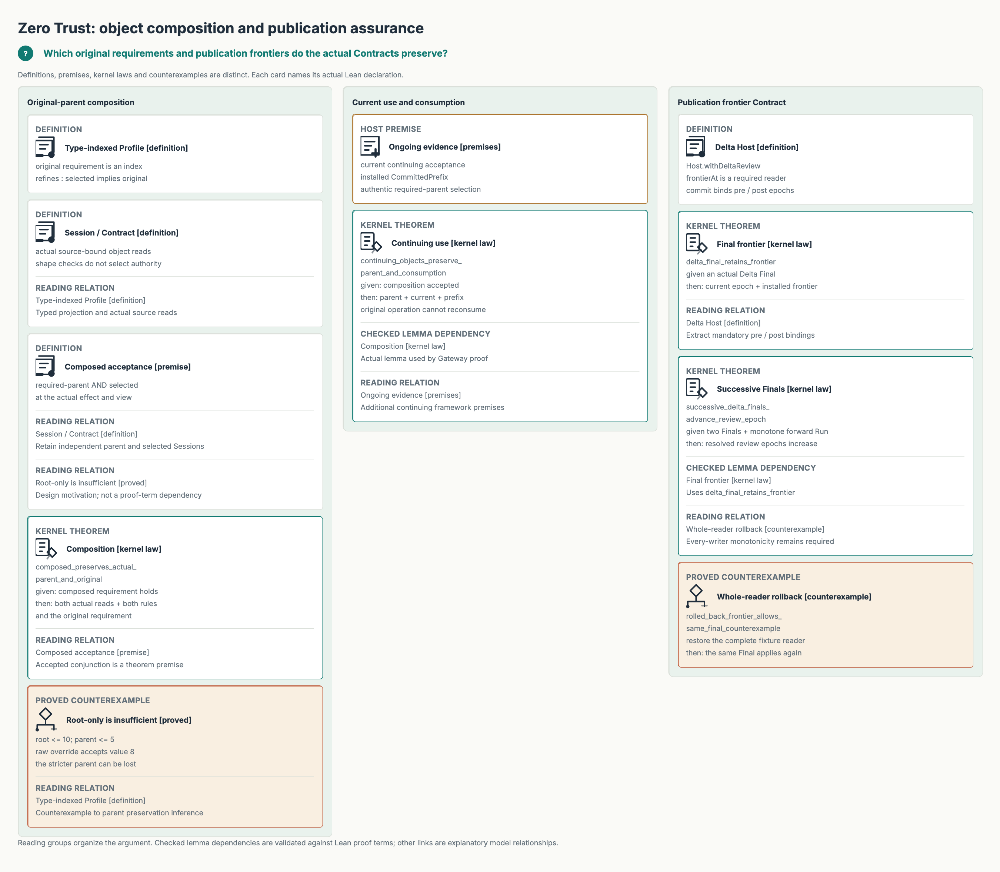
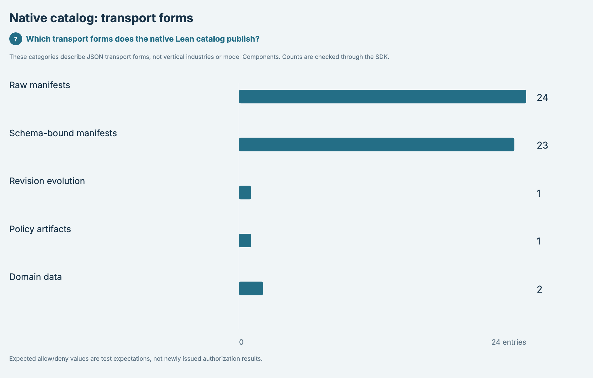

# SPDX-FileCopyrightText: 2026 hardenedlinux Linux Team and Contributors
# SPDX-License-Identifier: Apache-2.0

#+title: Lean JSON, SysML and hand-drawn engineering views
#+language: en

* One development path

Native Lean =caseManifestsNative catalog= publishes the existing SourceCatalog JSON.
=dev/catalog.ts= observes only entry headers, source-reference closure and counts;
it never parses Cedar policies or turns an expected allow/deny into a decision.
Opaque policy, schema and entity values remain =unknown= because their semantics
belong to the existing Lean/Rust owners, not to this display adapter.

=dev/sysml/lean-catalog.sysml= is generated from that exact JSON. Each original
entry retains its key, category, expectations and revision count as model data.
The overview displays category totals instead of squeezing all entries into one
unreadable diagram. The native catalog format number is read from its existing
producer contract; it is not a new Library version or namespace.

OpenSysML =connectWasm()= owns the published SDK's worker. =parseSources= receives
named source bytes, so actual SDK spans point to the SysML files. Parse errors
refuse; =renderView= supplies actual node identities, connections and model hash.
Category counts are evaluated through that same SDK model and compared with the
native JSON observation. No fabricated SDK snapshot or replacement service is used.

D2 owns Questions, display captions, icons and layout preferences. =bindView=
requires every authored subject to bind a unique SDK name and every authored edge
to match an actual SDK connection. Missing, additional or drifting relationships
refuse. Captions do not replace topology. These are logical specification handoffs,
not physical networking links or a proof that Lean import boundaries conform.

The installed deterministic-engineering renderer owns typed composition, font
measurement, ELK layout, Rough.js strokes and PNG/SVG/HTML exports. Long connection
labels become a readable source-bound legend; actual text must remain at least
12 CSS pixels. This local condition does not assert aesthetic acceptance.

* Distinct model scopes

The project architecture is compositional. Zero Trust is an important model
Component, alongside Authorization and other reusable capabilities. The optional
=ZeroTrust.ProfileObject= interpreter is not the LeanPoo foundation.

| View | Scope |
|------+-------|
|  | Foundations, shared model, selected Components, consumers and Host responsibilities. |
|  | Reusable library families; no requirement that every profile selects every Component. |
|  | Actual healthcare/financial-services controls and separate AWS/Google projections. |
|  | The Component's module relationships. |
|  | Conditional refinement, observation, mediated-use and recovery laws, with premises visible. |
|  | Root-only counterexample, retained parent/selected Sessions, composition and continuing use. |
|  | Native manifest forms/counts, not an industry classification. |

=architecture.sysml= authors ownership/composition relationships and binds them
to the referenced Lean/module documentation. The SDK verifies that the generated
view matches that model; this alone cannot prove the model is architecturally
correct. Regression checks require Zero Trust's Component role and a distinct
source-bound subject for every current Vertical and Platform directory.
The existing Lean import audit independently enforces Library/Production isolation.
Vehicle, procurement and other example families are not silently promoted into
implemented generic vertical libraries. Their domain facts remain with the cases.

* Native commands
Run from the repository root:
#+begin_src sh
cd dev
bun install --frozen-lockfile
just build
just render
just test
#+end_src

=bun run test= delegates to =just test=, which builds the required Lean test
modules before running Bun. Direct =bun test= skips that prerequisite and is
only appropriate after the standard build has completed. The proof suite reuses
one SDK-owned WASM worker; every source mutation is still parsed and checked
independently, with the original test deadlines unchanged.

=just build= uses the existing Lake target. =just prepare= directly executes the
existing compiled Lean producer; it does not start a benchmark or another test
runner. =just render= builds that existing target first and consumes those original bytes. Call =bun run render path=
with a different in-repository capture to inspect an explicitly supplied input.
The renderer rechecks source fingerprints before publishing and rejects an input
that changes while it runs. Benchmark and Rust acceptance are separate activities;
this view neither replaces them nor modifies their resource limits.

* Views and source ownership
| Input or output | Owner / purpose |
|-----------------+-----------------|
| =.generated/lean-catalog.json= | Original native Lean output; ignored build input |
| =sysml/security-frameworks.sysml= | Authored reusable-framework architecture |
| =sysml/lean-catalog.sysml= | Generated model data derived from the native catalog |
| =d2/*.d2= | Canonical Questions and presentation, without RAW TALA coordinates |
| =.generated/*-sdk.json= | Actual SDK capture, retained by model hash |
| =d2/*.png= | Hand-drawn documentation images; no external font load needed |
| =d2/*.svg= | Vector export with embedded font notices |
| =../.cache/render/dev/d2/*.html= | Browser verification intermediate; ignored by Git |
| =d2/*.json= | Input/output hashes, SDK spans/model hash, input counts and observations |

The source =CedarPooSpec/ZeroTrust/architecture.d2= and its RAW SVG are migrated to
this development path. The module README displays the new PNG and links its model
and D2. Existing topology and the four original relation captions remain checked.
Git history retains the old source; there is no active RAW renderer fallback.

* Views

See the scoped views above. PNG, SVG, SysML and D2 sources live together under
=dev/=; the root README embeds only the project architecture overview.

* Licensing
Cedar remains Apache-2.0, with its existing Cedar and Faré / POOF credits unchanged.
New development glue uses that license and HardenedLinux project attribution.
The renderer is installed by Bun from its reviewed upstream Git revision and
retains LGPL-2.1-or-later. No renderer source archive is committed here. OpenSysML packages retain their own Apache-2.0 license.
Kalam's actual 2014 Indian Type Foundry notice and OFL-1.1 are retained in exports.
JSON and PNG use standard REUSE sidecars; comment-capable sources
carry in-file SPDX headers. =../LICENSES= contains the canonical licenses this development subtree uses.

* Audit and invalidation boundary

The host discovers top-level =d2/*.d2= declarations; it contains no figure-name
switch. Questions, themes, icons, layout options and model/name bindings stay in
D2. The existing Render Library owns D2 compilation, SDK display projection,
ELK, font measurement, Rough.js and output serialization. The local composer
adds only Cedar's heading/legend composition; it implements no layout solver.

The finite catalog categories and format 2 describe the existing Lean wire
contract, not a second policy parser or version registry. Source pools remain
opaque. Malformed declared manifests/artifacts refuse instead of silently
becoming domain data. Catalog count expressions, categories and localized units live in the D2 =catalog.counts= declaration. The catalog adapter alone evaluates/counts them; generic projection accepts only explicit display captions.

=sources.ts= is the host filesystem boundary: it restricts input references to
the repository and compares captured content hashes before publication. It does
not replace the Library's figure fingerprints. Changed or missing SysML, D2,
JSON, imported host modules, dependency declarations or a consumed Lean producer
invalidates that figure.
Returning to identical bytes restores content identity; no mtime lease is invented.
Catalog receipts bind the actual producer executable separately from text
inputs. All receipts capture the Git dependency declaration and Bun lockfile. Source records are observations, not a signed compiler
attestation that a particular binary was derived from all transitive sources.

A changed source invalidates an old receipt; it does not erase historical images.
Run =just render= then =just test= to re-observe and validate current artifacts.
Native file renames are atomic per file, not across the whole bundle. The
receipt-last protocol makes partial bundles inadmissible: consumers must use
=verifyFigure= and recheck current sources before reuse.

* Platform verification

=.github/workflows/views.yml= builds the existing Lean producer, captures the
native JSON, parses/evaluates actual SysML, exports figures and runs positive /
negative controls on Linux and macOS. Platform outputs and SDK captures are
uploaded for inspection. Each platform regenerates its own producer/output
hashes; binary and image bytes are not required to match across platforms.
This CI qualifies the development rendering chain. The existing Cedar proof,
Rust, conformance and benchmark jobs retain their own acceptance boundaries.

* Proof-reading maps

The Zero Trust proof views retain actual fully qualified Lean declaration names
and source paths as SysML attributes. The SDK round-trips these attributes; the
existing test entrypoint builds the source proof modules, then Lean checks that
law/counterexample cards resolve to theorem constants and declared source paths
match their actual defining Lean modules. Premise/definition cards
are distinguished explicitly. The rendering does not create a certificate or
infer deployed Host behavior. Edges are authored logical premises/lemma uses;
the counterexample edge is explicitly design motivation. Full proof terms and
additional laws remain in the linked Lean sources and adjacent module guide.

* SDK proof declarations and adapter boundaries

D2 proof figures select a =proofs.namespace=. =proofs.ts= reads that scope with
the installed SDK's =Model.symbol= and =ModelSymbol.children=. Resolved part types
supply roles; SDK =eval= supplies the existing =<part>Symbol=, =<part>Source= and
optional =<part>Uses= attributes. There is no SysML text parser or fixed card count.
The current WASM backend supports these APIs but does not advertise Query;
no substitute query engine or SDK upgrade is introduced.

=Uses= names existing SysML declaration identities. The SDK resolves each identity
and supplies the selected views' actual edges. Unresolved references, unsupported
roles, orphan claims, duplicate claims and claims absent from the SDK topology
refuse. The two current proof-use claims are authored in SysML, not listed in TS.
Lean then checks existence, defining module, theorem kind and actual proof-term
uses. Imports come from the SDK-observed source declarations. The direct Lean
compiler invocation is verification, not a nested test/build runner.

Render receipts retain =proofClaims= and capture their declared Lean sources.
These are SDK observations of authored claims, not newly issued Lean certificates;
=just test= is the native checking entrypoint. Formatting changes and added valid
cards need no parser/count edits; false theorem labels and fabricated lemma uses
are negative controls, not rendered proof evidence.

=projection.ts= owns SDK/D2 identity and relation closure, icons and supplied
captions. It imports no catalog schema, category or English count formatter.
=catalog.ts= owns native catalog observation and =catalog.counts= validation.
D2 supplies singular/plural units; generic captions may use any source language.
The host reads the renderer Git specifier from the existing =package.json=
dependency declaration. Bun resolves and installs it; no archive locator,
second revision pin or custom dependency installer remains. Bun's frozen lock
continues to own dependency installation and transitive versions.

* Per-figure closure and interrupted exports

=inputs.ts= asks Bun's native bundler metafile for imported local host modules.
Adding an unimported TS file does not alter the footprint. Runtime dependency
identity remains in the existing package declaration and frozen Bun lockfile;
the installed package exports its own version metadata.

D2's existing =references= declare file dependencies, including imported D2
fragments. A provisional native compile reads the declaration; the final native
compile receives only the entry and referenced D2 files. Undeclared direct or
transitive imports therefore fail in D2 itself. There is no import parser,
parallel dependency manifest or custom resolver. Referenced SysML documents are
parsed together through =parseSources=; unresolved model references refuse.
Explicitly cited Org/Lean files are captured as bytes. This does not claim a
recursive semantic audit of every hyperlink in a cited document.

Each receipt contains common execution inputs, the selected D2/reference closure,
selected model sources, SDK capture and declared proof sources. Only views that
consume catalog data or its generated model capture native catalog JSON, producer
binary and its build declarations. Unrelated D2 changes and producer changes do
not invalidate an architecture-only view. A change inside a shared referenced
file still invalidates its consumers; granularity is per file, not per AST span.

=artifacts.ts= is a filesystem adapter over the existing renderer receipt. It
removes the old active receipt before invoking the exporter, stages complete
bytes in a temporary directory, checks current sources, renames outputs and
commits the receipt last. Browser interruption or a mid-write filesystem error
leaves no acceptable active receipt. Existing image files may remain for diagnosis;
their presence is not success. No publisher service or transaction framework is
introduced, and failures are propagated.

=verifyFigure= checks the requested entry, current source/binary hashes, every
PNG/SVG/HTML hash and native HTML provenance using parse5. HTML input identity and
source hashes must match the receipt. Missing files, malformed receipts, mixed
generations and even a complete bundle copied from a different entry refuse.
The host writes the native combined SVG and every scene SVG (=.scene-N.svg=),
checks the complete hash list, and rejects unlisted leftover scenes.
Receipt checks prove content consistency under the existing trusted-host boundary,
not a signed execution attestation or proof of image aesthetics.

For a single entry, after the standard installation:
#+begin_src sh
cd dev
bun run render .generated/lean-catalog.json dev/d2/architecture-overview.d2
#+end_src
An architecture-only entry does not read the supplied catalog path. Full
=just render= still prepares native catalog input for the inventory view.

Git installation is native:
#+begin_src sh
bun install --frozen-lockfile
#+end_src
The root manifest in the upstream repository exposes the package's sources under
=packages/render=. =vendor/= is ignored and absent from Git; Release archives are
not a development dependency.

* Browser intermediate cleanup and verification budgets
Generated HTML is not a source or documentation deliverable. It is absent from
=dev/= and Git. The filesystem adapter removes legacy adjacent HTML and writes
new browser intermediates only under the root =.cache/render/= directory. Native
HTML hash/provenance validation remains active; CI uploads this ignored cache as
build diagnostics. PNG/SVG are the documentation outputs.

The SDK declaration/receipt comparison and native Lean validation are independent
checks. Each retains the existing 30-second per-test bound; native Lean keeps its
2048 MiB / 10000000-heartbeat arguments. The native check consumes the emitted SDK
capture only after receipt validation, rather than charging SDK discovery and
compiler startup to one combined test. Stage timing and child termination signal
are recorded. This is not a retry policy or an extension of either method budget.

* Downstream Git installation, cold start and recovery

=package.json= declares the reviewed Render Git commit and =bun.lock= records
Bun's resolution/integrity data. The installed upstream =package.json= remains
the version source. Neither =dev/vendor/= nor a GitHub Release asset participates
in installation. Do not copy a tarball or create a second package manifest.

The engineering-views CI uses a job-local empty Bun cache for its first frozen
install, then runs the existing producer/render/typecheck/test entries. A later
step deletes only =dev/node_modules/= and installs again from the same lockfile,
then starts a new Bun process to verify the existing real SDK/browser exports.
Recovery also exercises the installed Render/D2 worker through the existing input
closure tests. It does not regenerate outputs or reissue their receipts to pass.
The lockfile and manifest must remain unchanged. This qualifies Render dependency
and view recovery; it is not a claim of a fully uncached Lean/toolchain build.

The real architecture-overview bundle is copied to a new temporary repository root
with only its captured inputs. Recovery fails without its HTML cache, then passes
after the original cache is restored. Changes to actual D2, referenced SysML,
adapter, package manifest or Bun lock invalidate the old receipt; restoring exact
bytes makes it current again. Missing HTML is rejected again. The view restores
without a catalog binary, vendor tree or Release asset. Existing interrupted and
mixed-output controls remain. Tests never launch installers or nested test runners.

After a normal Git checkout, use the existing entries:
#+begin_src sh
cd dev
bun install --frozen-lockfile
bunx playwright install chromium
just render
just test
# Dependency recovery; retain sources and existing exports.
rm -rf node_modules
bun install --frozen-lockfile
bun run typecheck
bun test ./test/sources.test.ts ./test/inputs.test.ts ./test/artifacts.test.ts
#+end_src
If the ignored HTML cache was lost, verification must fail. Use =just render= to
produce a fresh complete bundle rather than editing hashes or accepting surviving
PNG/SVG. Browser/dependency assets inside =node_modules/= belong to their packages;
they are not project HTML outputs.

Local qualification on 2026-11-02 used an independent checkout and empty Bun cache:
94 packages installed in 13.14 s; native architecture rendering and receipt
verification passed with 21 source files and no producer binary. Removing the
installation and reinstalling the same lockfile restored 94 packages in 436 ms;
a new process accepted the unchanged original export. These are recorded local
observations, not cross-platform performance guarantees.

The native proof checker imports only the Lean command-evaluation and constant-use
inspection modules it consumes. It still checks the entire SDK capture and all
existing negative controls within the same per-test memory/heartbeat/time bounds.
See the shared-plan Org audit for the preserved macOS failure and import profile.

* Released compiler lifetime capability

The selected Render Git source includes upstream PR #5. Compiler allocation and
IPC lifecycle belong to that Library: each compile owns its SDK worker and native
process, and settles only after native close. Cedar keeps using the same public
=compileModel= API; it adds no subprocess wrapper, pool or alternate D2 compiler.
The reviewed release source is linked by =package.json= and Bun's lockfile. Read
the actual installed name/version instead of declaring a second version here:
#+begin_src sh
bun -e 'import metadata from "@deterministic-engineering/render/package.json"; console.log(metadata.name, metadata.version)'
#+end_src

Updating the real Git revision and native lock invalidates previously accepted
figure receipts. The preserved local control accepted the original architecture
receipt before the update, then refused it with =Captured source changed= for
=dev/bun.lock=. All seven views are regenerated using the new installed Library;
SDK/Lean interpretation, Questions and layout declarations are unchanged.
The existing cold-install, exact-source and dependency/worker/artifact recovery
checks apply to this released source, without consuming a Release attachment.
