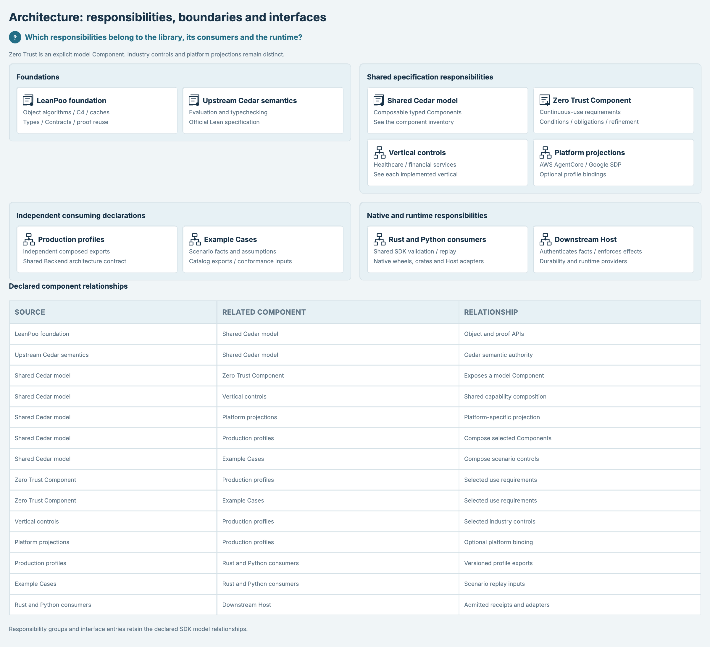
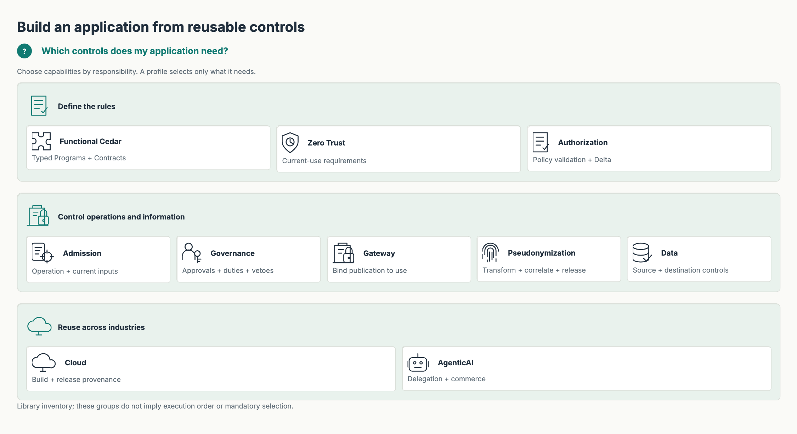
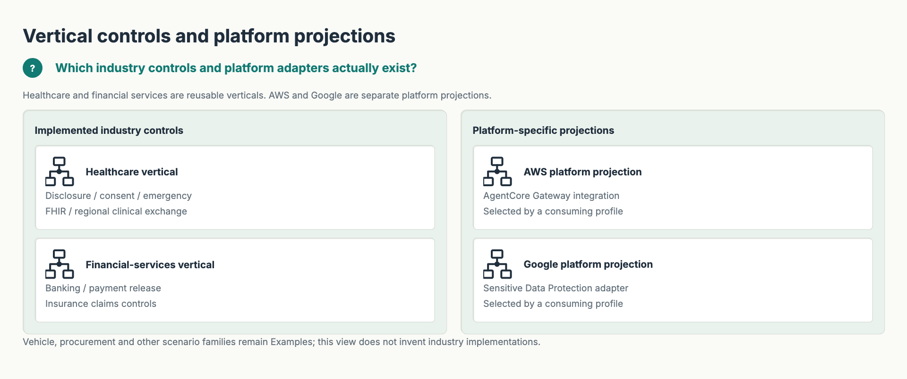
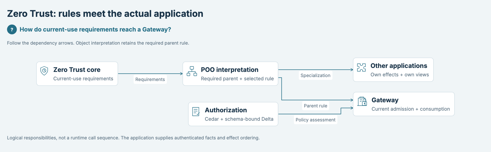
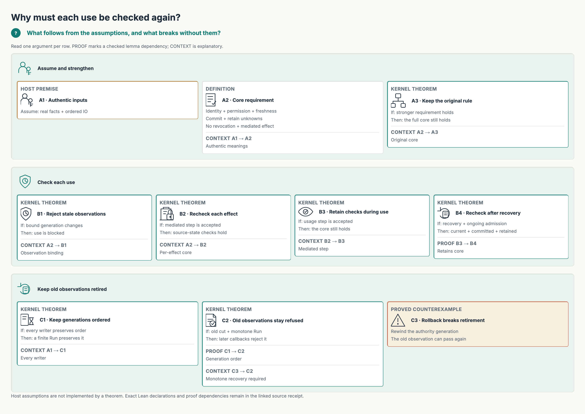
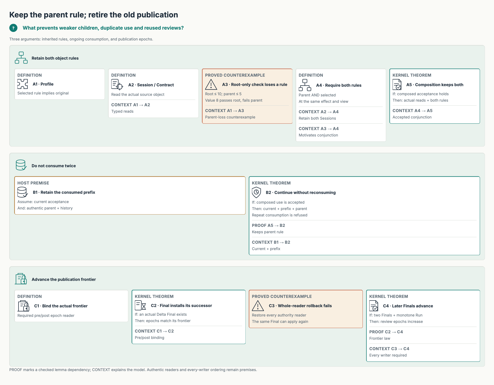
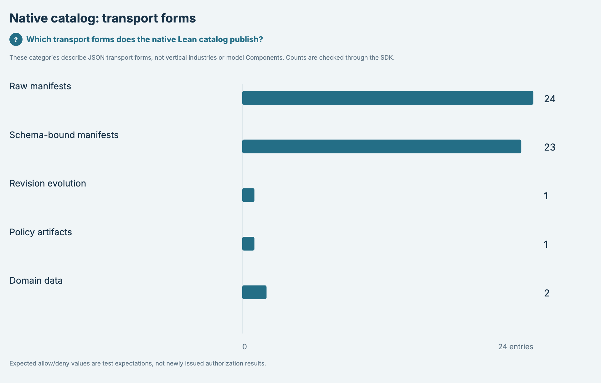
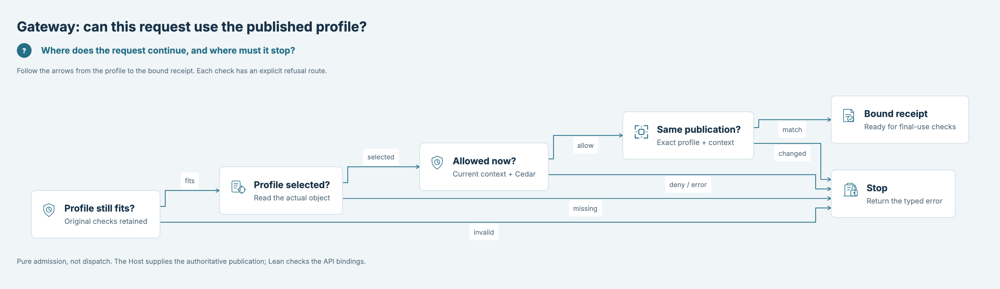
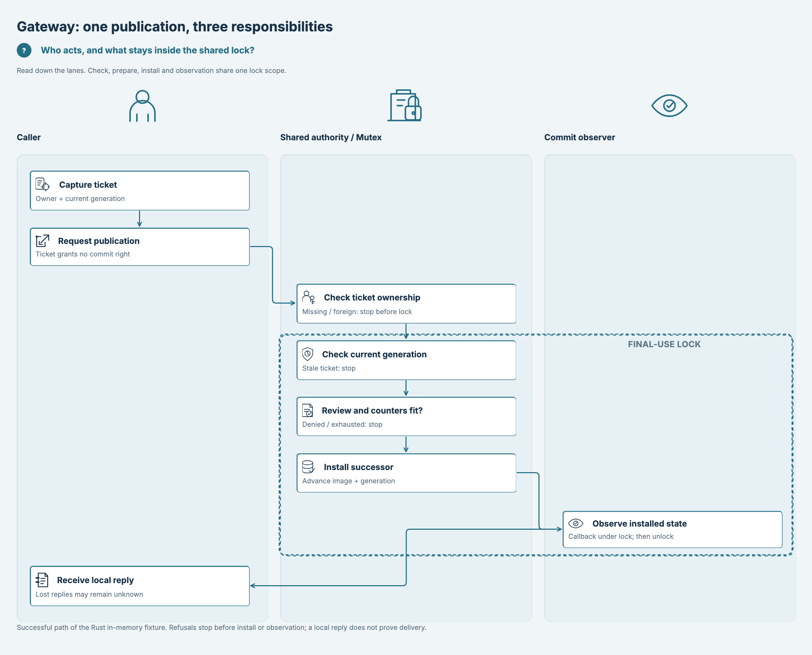
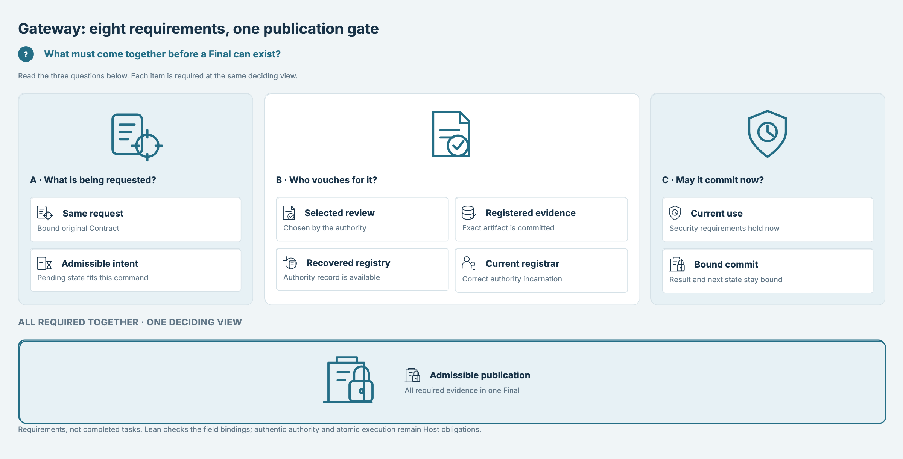

# SPDX-FileCopyrightText: 2026 hardenedlinux Linux Team and Contributors
# SPDX-License-Identifier: Apache-2.0

#+TITLE: 全部架构图的学生视角审计
#+LANGUAGE: zh-CN
#+OPTIONS: toc:2

* 结论与范围

日期：2026-11-03。基线：=3506f8707de648c98ba033e85de9e94b915ed337=。
本轮覆盖 =dev/d2/= 全部十张顶层图，包括 README 的第一张架构图。
这是作者以初学者任务进行的逐图设计审查，没有招募真实学生，也没有阅读时间、
正确率或认知负荷实验数据。因此结论是“已修正列出的阅读障碍”，不是“已验证所有学生读懂”。

主要问题：重复文字取代图形关系；相同图标不能区分职责；不均衡长列放大空白；
证明名和源码名过早挤占第一层信息。此次统一重画题目、短文案、图示和布局，
仍保留各图不同的语义：依赖图、目录、数量分布、条件论证、流程、泳道和必要条件。

普通入口图用于建立方向；两张证明图是进阶阅读，仍需要概念讲解。
不能把“减少词数”“缩短画布”或自动检查通过等同于理解成本已经得到实证改善。

* 审查方法

目标读者：了解基本编程，但不熟悉本项目命名、Lean 证明和 Gateway 生命周期的学生。
对每张图先隐藏源码，检查以下问题，再与 Lean/SysML 绑定核对：

1. 第一眼能否说出图回答的问题？标题是否重复长段说明？
2. 能否找到入口、主要关系和停止/完成条件？静态关系是否被误画成工作流？
3. 图标、边界、方向、分组是否承担解释，而不是装饰？
4. 相邻内容是否相关？空白是角色/分支的必要位置，还是列高失衡造成的浪费？
5. 能否在不读函数名的情况下回答下面的理解题？必要技术词能否到第二层查找？
6. 简化后是否仍区分前提、已证明结论、反例和 Host 尚需提供的能力？

设计参考：[[https://doi.org/10.1017/9781108894333.019][Mayer/Fiorella 的多媒体学习原则]]。
此次借鉴去除无关内容、提示结构和图文空间邻近，未把配音场景的冗余原则
机械解释为静态图必须删除所有文字；也未把这些研究当成本项目的用户实验。

* 逐图 Reflection 与 Review

** 架构总览

 · [[file:../dev/d2/architecture-overview.d2][图源]] · [[file:../dev/d2/architecture-overview.json][来源及绑定记录]]

- 原问题：四个责任区再接十四行关系表；读者要反复查找同一名字。
- 修改：四个图标问题引导一张原生依赖图；去掉重复关系表，保留全部十四条边。
- 学生理解题：Production 是否从 Examples 获得定义？
- 预期解释：不。两者独立消费共享能力，再交给 Rust 回放。Zero Trust 是模型 Component。
- 复查结论与剩余难点：十四条边仍有分支；缩略图用于定位，精读应打开原图。

** 能力目录

 · [[file:../dev/d2/model-components.d2][图源]] · [[file:../dev/d2/model-components.json][来源及绑定记录]]

- 原问题：三列分别有三、五、两个对象，列高失衡，图标也无法区分职责。
- 修改：改为规则、操作与信息、跨行业三排；使用拼图、盾牌、凭据、指纹、存储、云和代理等不同图示。
- 学生理解题：是否必须选用全部 Component？
- 预期解释：不。按应用所需组合；这些分组不是执行顺序。
- 复查结论与剩余难点：Functional、Delta 等术语仍需入口说明，不能由图标单独定义。

** 行业与平台

 · [[file:../dev/d2/verticals-platforms.d2][图源]] · [[file:../dev/d2/verticals-platforms.json][来源及绑定记录]]

- 原问题：四个相同模型图标，难以一眼分清行业规则和平台接入。
- 修改：按两个问题分排，以医院、银行、云和数据保护图示区分。
- 学生理解题：AWS 是一个垂直行业吗？
- 预期解释：不是；Healthcare/Financial services 是行业能力，AWS/Google 是平台投影。
- 复查结论与剩余难点：只展示已实现的库；其他 Example 场景不能自动升级为行业实现。

** Zero Trust 责任

 · [[file:../dev/d2/security-frameworks.d2][图源]] · [[file:../dev/d2/security-frameworks.json][来源及绑定记录]]

- 原问题：整图是三列表格，重复目标名称，末两行关系列为空。
- 修改：五个职责节点与四条有方向的依赖边；保留父规则与策略评估的汇合。
- 学生理解题：Gateway 只需要 Zero Trust core 吗？
- 预期解释：不；图中同时接收 POO 保留的父规则和 Authorization 的策略评估。
- 复查结论与剩余难点：依赖箭头不是运行顺序，也不证明 Host 输入真实。

** 模型证明

 · [[file:../dev/d2/zero-trust-model-proofs.d2][图源]] · [[file:../dev/d2/zero-trust-model-proofs.json][来源及绑定记录]]

- 原问题：完整声明名、分类、源名称和关系说明多次重复，形成高文本列。
- 修改：每排一个论证；用 A/B/C 索引、前提/结论及反例区分，完整符号移到本报告索引。
- 学生理解题：为什么回滚会让旧 observation 再次通过？
- 预期解释：因为每个写入者保持代次单调的前提被破坏；仅声明 mediated 不够。
- 复查结论与剩余难点：属于第二层学习图；学生需先理解 observation、generation 和 Run。尚不能宣称零基础可独立读懂。

** 对象与发布证明

 · [[file:../dev/d2/zero-trust-object-proofs.d2][图源]] · [[file:../dev/d2/zero-trust-object-proofs.json][来源及绑定记录]]

- 原问题：原父规则五卡、持续使用两卡、frontier 四卡放在等宽长列，文本和空白都过量。
- 修改：分成三排论证；保留数值反例、父与子规则合取、消费前缀及发布前后沿的条件。
- 学生理解题：root ≤ 10、parent ≤ 5，数值 8 能被子对象接受吗？
- 预期解释：不能只因通过 root 就接受；必须保留独立选定的 parent 要求。
- 复查结论与剩余难点：三个论证不能当成一个无条件安全定理。frontier 与历史前缀仍需先解释；图中明确拒绝的是重复消费，不是拒绝所有持续使用。

** 原生目录数量

 · [[file:../dev/d2/lean-catalog.d2][图源]] · [[file:../dev/d2/lean-catalog.json][来源及绑定记录]]

- 原问题：五排条形图行距很大，没有先给出总量。
- 修改：增加从实际观测求和的总量，收紧行距，保留同零点尺度并加入分类图标。
- 学生理解题：24 个 raw 条目是否意味着 24 次授权成功？
- 预期解释：不是。数量描述传输形式；总计为 51 个目录条目。
- 复查结论与剩余难点：不是行业覆盖统计，也不是新的授权结果。图标用于辨认类别，数值仍由 SDK 观测。

** Profile 授权流程

 · [[file:../dev/d2/gateway-profile-workflow.d2][图源]] · [[file:../dev/d2/gateway-profile-workflow.json][来源及绑定记录]]

- 原问题：主路径与所有失败分支很宽，节点副文案仍偏长。
- 修改：缩短检查和返回标签；停止节点使用警告图标，保留所有失败箭头。
- 学生理解题：得到 bound receipt 后是否可以直接发出外部效果？
- 预期解释：不可以；还需要 final-use 检查和 Host 执行边界。
- 复查结论与剩余难点：所有错误汇合为 Stop；具体错误变体需读类型/API，而不是强塞进概览图。

** 发布泳道

 · [[file:../dev/d2/gateway-publication-swimlanes.d2][图源]] · [[file:../dev/d2/gateway-publication-swimlanes.json][来源及绑定记录]]

- 原问题：八个阶段的纵向间隔和角色图示占据较大画布。
- 修改：缩短角色标题区和阶段高度；保留角色空位，箭头间距与连续锁区域，owner 检查仍在锁外。
- 学生理解题：observer 是否位于安装完成后的同一个锁内？
- 预期解释：是；安装、观察仍共享边界，随后解锁并返回本地回复。
- 复查结论与剩余难点：角色空位有语义，不能为了填满空间删除；本地回复不代表远端收到。

** Final 必要条件

 · [[file:../dev/d2/gateway-final-tasks.d2][图源]] · [[file:../dev/d2/gateway-final-tasks.json][来源及绑定记录]]

- 原问题：上一轮已分三区，但大图标与结果区重复占据较多高度。
- 修改：减小重复场景图示、收紧结果区，保留三问、八字段及 AND 合取含义。
- 学生理解题：八项条件是否按 A、B、C 的顺序执行？
- 预期解释：不是。它们必须在同一个 deciding view 同时成立。
- 复查结论与剩余难点：类型字段存在不等于真实凭据；Host 认证、持久化和原子执行仍是前提。

* 可复核的文字与空间变化

下面按 SVG 的可见 =text= 元素提取英文字母/数字词元（正则 =[A-Za-z0-9]+=）；
不统计 metadata、CSS、路径或来源 JSON。PNG 高度折算到同一显示宽度 1200，
避免仅靠更改导出宽度制造“变矮”。取整值只描述布局，不是阅读时间或学习成绩。
图标变多可能增加文件字节数，所以文件大小也不作为认知质量评分。
行业/平台图的等宽高度略增，明确保留该结果；它换来了两个独立问题区，不能宣称每图都变矮。

| 图 | 可见词元：原 → 新 | 等宽高度：原 → 新 | 源码最小字号 CSS px |
|----+------------------+------------------+--------------------|
|  | 276 → 95 | 1095 → 436 | 13.00 |
|  | 131 → 87 | 697 → 654 | 13.00 |
|  | 89 → 64 | 502 → 524 | 13.00 |
|  | 129 → 69 | 544 → 372 | 13.00 |
|  | 346 → 260 | 880 → 851 | 13.00 |
|  | 386 → 269 | 1047 → 936 | 13.00 |
|  | 62 → 59 | 766 → 685 | 13.00 |
|  | 91 → 74 | 347 → 344 | 13.00 |
|  | 111 → 100 | 969 → 883 | 13.00 |
|  | 124 → 118 | 612 → 594 | 13.00 |

最小字号门禁仍为 12 CSS px，指原始导出画布，不保证 GitHub 缩略图或手机缩放后的字号。
宽图先用于定位；证明细节需打开原图。没有以降低字号门限或截掉声明/关系换取紧凑布局。

* 短词表：进入证明图前

| 词 | 先理解成什么 |
|----+--------------|
| Contract | 对输入、结果和状态关系的要求；不是已经发生 IO 的证明。 |
| Profile | 一组可组合的要求；选中子规则时仍须保留必需父规则。 |
| Observation / generation | 观察值与其所属代次；值相同不意味着代次仍有效。 |
| Frontier / epoch | 约束旧审查是否还能被接受的独立权威前沿与版本。 |
| CommittedPrefix | 当前历史确实保留了原操作消费记录；不是只看一个 committed 标签。 |
| Host premise | 应用需要提供的可信事实或原子顺序；Lean 定理不会自动实现它。 |

* 进阶索引：图中短编号对应的真实 Lean 声明

此表只负责查找；声明存在性、定义模块、角色和 PROOF 使用边继续由现有 SDK/Lean 校验。
图上的短编号由声明的阅读分组生成，不是新的证明身份。

| 图 | 编号 | 真实声明 |
|----+------+----------|
| zero-trust-model-proofs | A1 | [[file:../CedarPooSpec/ZeroTrust/Model.lean][CedarPooSpec.ZeroTrust.Framework]] |
| zero-trust-model-proofs | A2 | [[file:../CedarPooSpec/ZeroTrust/Composition.lean][CedarPooSpec.ZeroTrust.Framework.required]] |
| zero-trust-model-proofs | A3 | [[file:../CedarPooSpec/ZeroTrust/Composition.lean][CedarPooSpec.ZeroTrust.with_requirement_preserves_framework]] |
| zero-trust-model-proofs | B1 | [[file:../CedarPooSpec/ZeroTrust/Continuous.lean][CedarPooSpec.ZeroTrust.changed_generation_blocks]] |
| zero-trust-model-proofs | B2 | [[file:../CedarPooSpec/ZeroTrust/Continuous.lean][CedarPooSpec.ZeroTrust.effect_step_rechecks]] |
| zero-trust-model-proofs | B3 | [[file:../CedarPooSpec/ZeroTrust/UsageControl.lean][CedarPooSpec.ZeroTrust.usage_retains_core]] |
| zero-trust-model-proofs | B4 | [[file:../CedarPooSpec/ZeroTrust/UsageControl.lean][CedarPooSpec.ZeroTrust.usage_rechecks_after_recovery]] |
| zero-trust-model-proofs | C1 | [[file:../CedarPooSpec/ZeroTrust/Continuous.lean][CedarPooSpec.ZeroTrust.run_generation_monotone]] |
| zero-trust-model-proofs | C2 | [[file:../CedarPooSpec/ZeroTrust/Continuous.lean][CedarPooSpec.ZeroTrust.Observation.retired_cut_refuses_after_run]] |
| zero-trust-model-proofs | C3 | [[file:../Tests/ZeroTrust/Functional.lean][CedarPooSpec.ZeroTrustTest.authority_rollback_revives_cut_counterexample]] |
| zero-trust-object-proofs | A1 | [[file:../CedarPooSpec/ZeroTrust/ProfileObject.lean][CedarPooSpec.ZeroTrust.ProfileObject.Profile]] |
| zero-trust-object-proofs | A2 | [[file:../CedarPooSpec/ZeroTrust/ProfileObject.lean][CedarPooSpec.ZeroTrust.ProfileObject.Session]] |
| zero-trust-object-proofs | A3 | [[file:../Tests/ZeroTrust/ProfileObject.lean][CedarPooSpec.ZeroTrustObjectTest.raw_override_parent_weakening_counterexample]] |
| zero-trust-object-proofs | A4 | [[file:../CedarPooSpec/ZeroTrust/ProfileObject.lean][CedarPooSpec.ZeroTrust.ProfileObject.Composed.requirement]] |
| zero-trust-object-proofs | A5 | [[file:../CedarPooSpec/ZeroTrust/ProfileObject.lean][CedarPooSpec.ZeroTrust.ProfileObject.composed_preserves_actual_parent_and_original]] |
| zero-trust-object-proofs | B1 | [[file:../CedarPooSpec/Gateway/ZeroTrust.lean][CedarPooSpec.Gateway.ZeroTrust.CommittedPrefix]] |
| zero-trust-object-proofs | B2 | [[file:../CedarPooSpec/Gateway/ZeroTrust.lean][CedarPooSpec.Gateway.ZeroTrust.continuing_objects_preserve_parent_and_consumption]] |
| zero-trust-object-proofs | C1 | [[file:../CedarPooSpec/Gateway/PublicationReview.lean][CedarPooSpec.Gateway.PublicationReview.Host.withDeltaReview]] |
| zero-trust-object-proofs | C2 | [[file:../CedarPooSpec/Gateway/PublicationReview.lean][CedarPooSpec.Gateway.PublicationReview.delta_final_retains_frontier]] |
| zero-trust-object-proofs | C3 | [[file:../Tests/Gateway/PublicationReview.lean][CedarPooSpec.Gateway.PublicationReviewTest.rolled_back_frontier_allows_same_final_counterexample]] |
| zero-trust-object-proofs | C4 | [[file:../CedarPooSpec/Gateway/PublicationReview.lean][CedarPooSpec.Gateway.PublicationReview.successive_delta_finals_advance_review_epoch]] |

* 验证与未闭合项

逐张打开完整 PNG 复查；检查图文邻近、连线遮挡、长列空白和角色含义。
第一轮人工复查发现了连线穿字与目录图标异常放大，已改为原生图布局和明确 SVG 尺寸。
泳道仍保留必要箭头间距，而不是追求最小面积。
本轮完整本地开发门禁通过：52 项测试、321 个断言；Org 文档解析和 diff 检查通过。
十图保留 12 CSS px 门限，身份、边、证明角色及全部 Final 字段的正负校验仍运行。
首轮三项用例因未加载项目图标资源失败，已统一使用同一个项目资源入口修正；未删减用例。
远端最终结果随本次 PR 报告给出；旧提交的绿色 CI 不能代表重画后的提交。

未闭合：真实学生理解测试、窄屏阅读表现、证明词汇的教学效果。
可使用本报告逐图理解题做访谈：先让学生解释，再揭示预期答案；记录误读而不是引导答对。
在取得这些观察前，不填造评分、通过率或“理解速度提升”。

* 与论文和安全模型的衔接

[[file:zero-trust-contract.org::*Research review: authorization, information flow and actual effects][安全模型研究审查]] 重新区分策略变更、当前事实、持续使用和实际效果。
图中的宿主前提必须保留：同世界 Delta 不增权，不等于跨世界或整条代理轨迹安全；
缓存的策略分析和 PyO3 回放 receipt 都不能充当新的执行授权。

构建范围也已明确：对外 =cedar-poo-bridge= 使用 PyO3/maturin；
外部进程观测包 =cedar-poo-py-test= 仍为 Python/uv_build。见 [[file:python-native.org][原生 Python 边界]]。

所有重画应与 D2、SVG、PNG 和来源记录一起进入现有草稿 PR #12。
PR 未合并期间 =main= 的图片不会自动变成分支图片；不要据此绕过“不合并”的约束。
